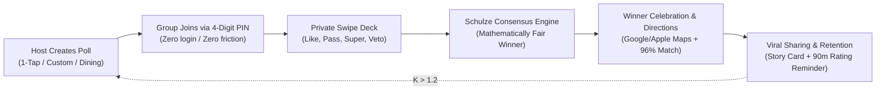
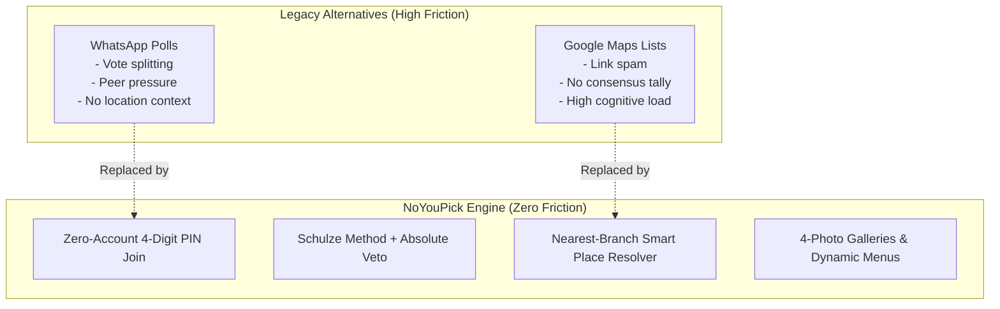
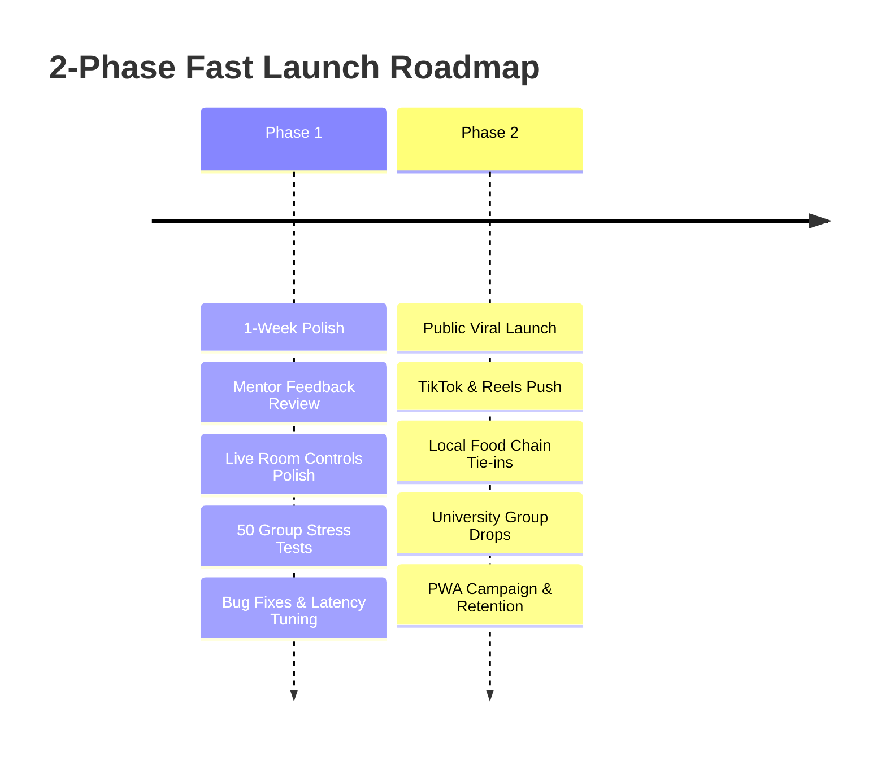
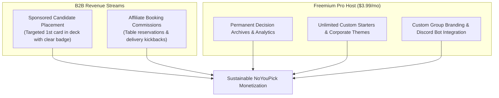

# NoYouPick - Product Decisions & Personal Release Plan
**Team Name**: `NoYouPickTheTeamName`  
**Product**: NoYouPick (Live at [noyoupick.org](https://www.noyoupick.org))  
**Framework**: [AI Hero Grill-Me Product Discovery Protocol](https://www.aihero.dev/skills-grill-me)  
**Date**: October 25, 2026  
**Status**: Ready for Mentor Marketing & Personal Release Strategy

---

## Executive Summary

**NoYouPick** is a zero-friction, mobile-first group consensus PWA designed to permanently solve the universal "I don't care, where do you want to eat?" stalemate. By pairing a Tinder-style private swiping deck with rigorous **Schulze Condorcet voting math**, absolute **Veto power**, and **GPS nearest-branch routing**, NoYouPick compresses 30-minute group chat arguments into a 60-second social decision game.

This document compiles the exhaustive product architecture, market positioning, viral acquisition mechanics, and 2-phase release strategy produced through the `/grill-me` discovery process to equip our mentor with all necessary data for crafting the marketing plan and release roadmap.

---

## 1. Product Identity & Core Value Proposition

| Dimension | Decision & Specification |
| :--- | :--- |
| **Team Name** | `NoYouPickTheTeamName` |
| **Product Name** | **NoYouPick** (`NoYouPick.org`) |
| **Tagline** | *"Stop arguing. Start eating."* |
| **Elevator Pitch** | NoYouPick eliminates group indecision by turning dinner, movie, and hangout choices into a private, 60-second swiping game powered by the Schulze Condorcet voting algorithm and absolute Veto power. |
| **Core Problem** | Group decision paralysis. In typical WhatsApp/Telegram group chats, suggestions trigger endless polite passivity (*"I don't mind, you pick"*) or vocal minorities overriding the quiet majority. Existing solutions (WhatsApp polls, Google Maps lists) suffer from vote-splitting, peer pressure, and lack of spatial proximity awareness. |
| **Primary Value Metric** | **Median Decision Time < 60 seconds** with zero social friction or lingering resentment. |

---

## 2. Target Market & Beachhead Persona

### 2.1 Beachhead Audience: Gen Z & Young Socialites (18-28)
- **Profile**: University students, young professionals, flatmates, and friend groups in urban hubs who socialize in groups of 3 to 8 multiple times per week.
- **Pain Point**: Spends 20-45 minutes daily or every weekend debating dinner spots, bars, movie nights, or party activities.
- **Why They Love NoYouPick**:
  1. **Zero Registration**: Nobody has to download an app from the App Store or create an account; just click a link or enter a 4-digit PIN in Safari/Chrome.
  2. **Privacy from Peer Pressure**: Votes are private until consensus is revealed - introverts can pass or veto expensive places without awkwardness.
  3. **Multi-Branch Accuracy**: Automatically routes to the nearest McDonald's, KFC, Andy's Pizza, or Star Kebab branch without manual address searching.

### 2.2 Secondary Personas
- **Couples**: Nightly *"What's for dinner?"* ritual without arguments.
- **Casual Gaming / Discord Guilds**: Deciding what Steam game to play (CS2, Deadlock, Catan) or what movie to stream on Discord.

---

## 3. Competitive Moats & Architectural Edge

1. **Schulze Condorcet Voting Math**: Resolves pairwise preferences across the entire group, avoiding spoiler candidates and plurality vote-splitting.
2. **Hard Veto Power (`-100`)**: If one person cannot afford a venue or has severe dietary restrictions, a Veto guarantees the spot is eliminated, protecting psychological safety.
3. **Smart Place / Typo-Tolerant Resolver**: Handles messy input like `"macdonals"`, `"andys piza"`, or `"kfcc"` and maps them to verified GPS coordinates and road travel times.
4. **Offline-Resilient PWA**: Built with Vite + Tailwind CSS + WebSocket push, rendering cards at 120 FPS with instant haptic response.

---

## 4. Go-To-Market & Marketing Acquisition Strategy

### 4.1 Primary Organic Channel: TikTok & Instagram Reels Skits
- **Creative Angle**: Relatable humor illustrating the universal awkwardness of group dining indecision:
  - *Skit Format*: 4 friends sitting in a parked car starving for 40 minutes saying *"I don't know, what do you want?"* $\rightarrow$ One friend opens NoYouPick, sends a PIN $\rightarrow$ 42 seconds later they are driving to Andy's Pizza.
  - *Call to Action*: *"Try it tonight with your friends - noyoupick.org"*.
- **Creator Partnerships**: Micro-influencers in target metropolitan hubs (food bloggers, university campus creators) hosting live consensus showdowns with their followers.

### 4.2 Built-In Viral Coefficient ($K > 1.2$)
Every single room created naturally exposes 2 to 7 new users to the product:
1. **Host Initiates**: Host creates room $\rightarrow$ drops 4-digit link in group chat.
2. **Participants Experience Value**: Guests join with 0 signup barriers and experience the sleek swiping deck.
3. **Winner Screen Conversion**: When the winner is announced, guests see the **"Host Your Own Decision"** button and an **Auto-Generated Story Card** (*"Consensus Pick: Andy's Pizza • 96% Match • Decided in 42s"*), turning voters into tomorrow's hosts.

---

## 5. 2-Phase Personal Release Plan

### Phase 1: 1-Week Polish & Mentor Alignment (Immediate)
- **Objective**: Ensure the live app operates with zero friction and bulletproof stability.
- **Key Deliverables**:
  - [x] Streamlined Custom Poll Drawer with integrated typo-tolerant autocomplete.
  - [x] 1-Tap direct room launch from drawer.
  - [x] Micro-labels on card voting controls (Undo, Pass, Veto, Super, Like).
  - [x] First-card dismissible gesture hint pill.
  - [x] Accidental down-drag Veto threshold guard ($115$px+).
  - [x] Real-time Waiting Room participant roster (`✓ Done` vs `⏳ Voting...`).
  - [x] Full native localization across 6 languages (`ro`, `en`, `ru`, `de`, `fr`, `es`).
- **Success Criteria**: 50 test group sessions conducted with zero mentor confusion and sub-60-second completion.

### Phase 2: Full Public Viral Launch (Week 2 onwards)
- **Objective**: Execute social marketing push and drive organic viral adoption.
- **Key Deliverables**:
  - Launch 5 high-engagement TikTok/Reels skits targeting weekend dinner indecision.
  - Campus distribution across Chișinău student groups and food community Discord servers.
  - Activate 90-minute post-visit rating reminder system to collect crowd-sourced venue price and satisfaction calibration.
- **Success Criteria**: 1,000+ completed voting rooms in first 14 days, $K \ge 1.25$.

---

## 6. Retention & Habit Loop

To guarantee users return regularly rather than treating NoYouPick as a one-off novelty:

1. **90-Minute Post-Visit Rating Reminder**:
   - 90 minutes after consensus is reached, the browser prompts: *"How was dinner at Andy's Pizza?"*
   - Captures satisfaction stars and budget accuracy, automatically calibrating community recommendation weights.
2. **Personal Decision History**:
   - Remembers past consensus wins, pairwise duel stats, and favorite group spots accessible via `/history`.
3. **"Friday Night Outing" Recurring Cue**:
   - Push notification / local PWA reminder for regular room hosts: *"Friday night with the crew? Pick your spot in 60s"*.

---

## 7. Business Model & Monetization Roadmap

We adopt a **hybrid B2B Venue Partnership + Freemium Pro Host** model that keeps the core voting experience 100% ad-free:

1. **B2B Promoted Venues (Non-Intrusive)**:
   - Local dining chains and entertainment venues sponsor candidate cards within their category. Promoted cards are ranked fairly by the algorithm and subject to user veto like any other candidate.
2. **Affiliate Reservation & Transit Links**:
   - Commission earned on table bookings, Bolt/Uber rides to the winner destination, and food delivery.
3. **Freemium "Pro Host" Tier**:
   - Targeted at office team leads, event planners, and content creators needing custom branding, exported voting reports, and unlimited candidate pool expansions.

---

## 8. North Star Metrics & KPIs

Our mentor and growth team will measure launch performance against three primary metrics:

| Metric | Target Goal | Rationale |
| :--- | :--- | :--- |
| **Weekly Completed Consensus Sessions** | $\ge 2,500$ | Measures real utility and active weekly usage. |
| **Viral Coefficient ($K$)** | $\ge 1.25$ | Proves self-sustaining organic growth from participants becoming hosts. |
| **Median Decision Time** | $\le 55$ seconds | Validates product promise of speed over endless chat arguments. |
| **Post-Visit Rating Completion** | $\ge 28\%$ | Validates retention and feeds data calibration flywheel. |

---

## 9. Team Structure & Responsibilities

**Team Name**: `NoYouPickTheTeamName`

- **Full-Stack Product Engineering Lead**:
  - Core React Vite PWA, WebSocket architecture, Schulze Condorcet engine, mobile touch ergonomics, responsive styling, and PWA service worker caching.
- **Growth & Community Marketing Lead**:
  - TikTok/Reels creative production, influencer outreach, student ambassador network, copy localization, and analytics tracking.

---

## 10. Summary for Mentor Action

With all key product, marketing, and release decisions locked in:
1. **Marketing Plan Integration**: The mentor can directly structure creative campaigns around the **"car indecision skit"** viral hook, targeting the **18-28 Gen Z dining/hangout beachhead**.
2. **Release Plan Scheduling**: The mentor can formalize the **2-Phase Fast Launch** timeline, focusing on 7 days of tight mentor polish and testing followed immediately by the public viral push.
3. **Technical Health**: The product is deployed live in production on Render and Vercel at [noyoupick.org](https://www.noyoupick.org), passing all automated verification tests.
