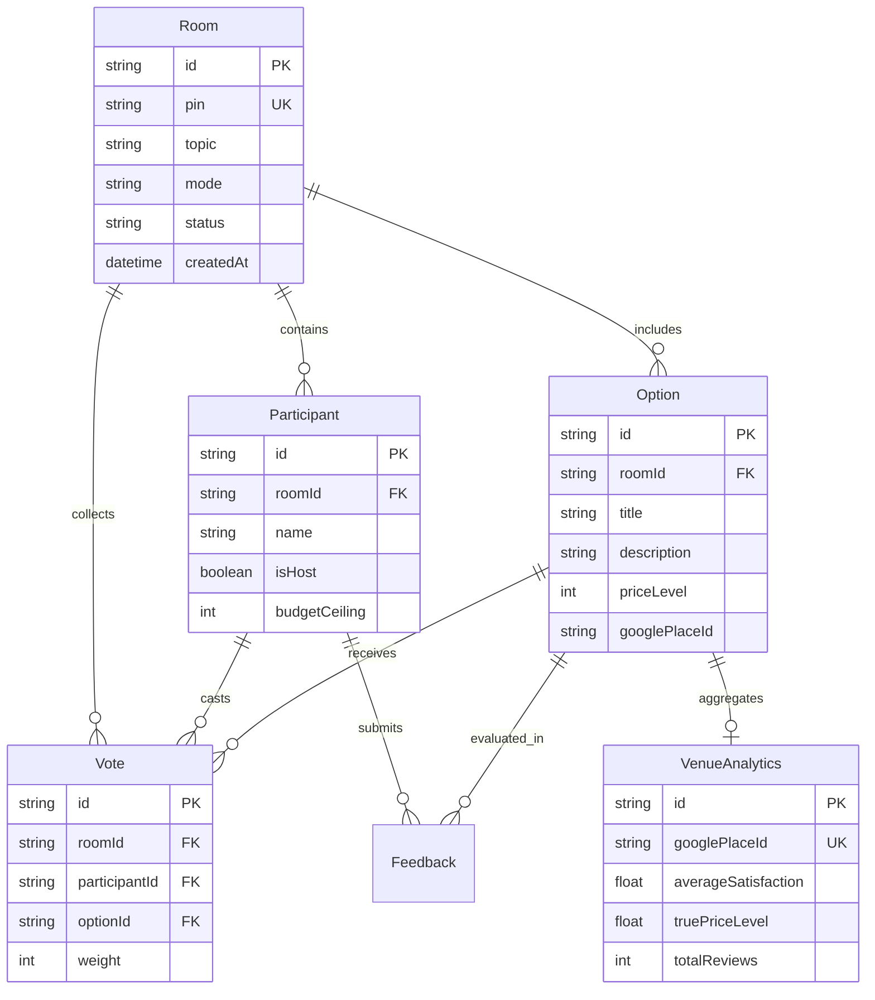

# THE REAL-TIME CONSENSUS ENGINE
## Comprehensive Technical Project Report

**A Domain-Native Real-Time Progressive Web Application for Social Choice Resolution**

```
========================================================================================================
 TECHNICAL REPORT METADATA
========================================================================================================
 Project Title     : The Real-Time Consensus Engine
 Version           : v1.0.0 (Production Release)
 Academic Host     : Technical University of Moldova (TUM)
 Faculty           : Faculty of Computers, Informatics and Microelectronics (FCIM)
 Study Programme   : Software Engineering (FAF-253, English Section)
 Academic Mentor   : Elena Gogoi, univ.lect., PhD
 Industrial Host   : S.R.L. EVANTAGE-SOFT (Software Engineering Division, bd. Moscova 11/8, Chișinău)
 Company Mentor    : Alexandru Andruh, Senior Software Engineer
 Project Timeline  : 01.09.2026 - 17.10.2026 (7 Sprints / 210 Engineering Hours)
 Student Authors   :
   1. Bahnă Sebastian   (Team Leader & Lead Frontend Architect)      [FCIM-25-016-PR-1]
   2. Oarza Gabriel     (Frontend UI/UX Engineer)                     [FCIM-25-016-PR-2]
   3. Fahed Maxim       (Backend Software Engineer)                   [FCIM-25-72413-PR-1]
   4. Martîn Lilia      (Backend Filtering & Real-Time Sockets)       [FCIM-25-243-PR-1]
   5. Dolinskaia Afina  (Algorithm & Data Analytics Engineer)         [FCIM-25-139-PR-1]
========================================================================================================
```

---

## EXECUTIVE ABSTRACT

Group decision-making is notoriously susceptible to social friction, circular indecision, and systematic voting paradoxes. Whether choosing a restaurant, social activity, or meeting agenda, groups of 3 to 8 participants frequently encounter the "tyranny of the majority", early-vote conformity bias, and social indifference ("I don't care, you pick"). Furthermore, existing digital tools fail due to high friction: conventional mobile applications demand multi-megabyte app store downloads and account registrations that cause high drop-off in spontaneous social settings.

To resolve these challenges, our engineering team designed and deployed **The Real-Time Consensus Engine**, a domain-native Progressive Web Application (PWA) operating under zero-install friction. Built with **React 19**, **Vite 8**, **Tailwind CSS v4**, **Node.js**, **Express 5**, **Socket.io 4**, and **Prisma ORM with PostgreSQL**, the system replaces chaotic polling with rigorous social choice theory. 

The application introduces four core innovations:
1. **Instant Session Ingress**: Users access private decision rooms via 4-digit PINs or QR codes in sub-3 seconds without downloading software or creating accounts.
2. **Confidential Step Zero Constraint Propagation**: Participants privately set individual spending ceilings; venues exceeding the minimum budget ($\min(B)$) are automatically pruned before voting starts, eliminating social embarrassment.
3. **The 3-Way Blind Vote**: Independent mobile card swiping featuring Approve (+1), Pass (-1), and an explicit VETO (-100) to protect against severe negative dealbreakers.
4. **Schulze Beatpath Resolution**: A Floyd-Warshall graph-theory variant ($O(C^3)$) offloaded to Node.js `worker_threads` that resolves pairwise voter preferences into a transitive Condorcet ordering in under 20 milliseconds.

The system was verified through end-to-end multi-client concurrency tests, automated unit test suites, and an automated accessibility audit achieving a verified 100/100 score under Apple Human Interface Guidelines (HIG). This report provides an exhaustive technical analysis of the problem domain, architectural topology, algorithmic foundations, engineering implementation, and verification outcomes.

---

## CHAPTER I: PROBLEM DEFINITION & DOMAIN ANALYSIS

### 1.1 The Psychology of Group Decision Breakdown
Social choice research identifies three core psychological failures that emerge during unstructured group decisions:
1. **The Responsibility Dilemma & Leader Fatigue**: Taking the initiative to propose a specific venue places social liability on the proposer. If the venue underperforms, the proposer bears peer blame. Consequently, participants default to evasive phrases ("Whatever everyone else wants"), stalling group action.
2. **Early-Vote Anchoring (Conformity Bias)**: In linear group chats (Telegram, WhatsApp), the first option to receive two public votes establishes an artificial psychological anchor. Due to conformity bias, subsequent voters align with the leading option rather than expressing genuine preferences.
3. **The Tyranny of the Plurality**: Plurality voting ("first-past-the-post") awards victory to the option with the most first-place votes, even if that option is intensely disliked by 60% of the group. A venue chosen by 3 enthusiastic voters can be utterly unacceptable to 4 others due to allergies, dietary constraints, or prohibitive costs.

### 1.2 The Software Friction Barrier
Consumer decision apps (such as Yelp Collections, Tinder-like food swipers) consistently fail in spontaneous social contexts due to structural friction:
- **Download Overhead**: Requiring 4 to 8 individuals sitting at a table to download a 50MB mobile APK or iOS bundle produces severe adoption friction and drop-off.
- **Authentication Walls**: Forcing social participants to verify email addresses or OAuth providers before casting a ballot destroys spontaneous utility.

### 1.3 Comparative Analysis of Decision Paradigms

| Evaluation Criteria | Chat Group Polling | Tinder-style Food Swipers | Borda Count Tool | The Consensus Engine |
| :--- | :--- | :--- | :--- | :--- |
| **Ingress Friction** | Low (inside chat) | High (Native Store App) | Medium (Web link) | **Zero (PWA / 4-Digit PIN)** |
| **Vote Independence** | None (Public tallies) | Partial (Pairwise binary) | High (Ranked form) | **Complete (Blind Private Deck)** |
| **Dealbreaker Protection** | None | None | None | **Explicit VETO (-100 Weight)** |
| **Budget Confidentiality** | None (Public disclosure) | None | None | **Step Zero Anonymous Prune** |
| **Algorithmic Rigor** | Plurality ($O(1)$) | Simple Sum ($O(N)$) | Positional Sum ($O(N \cdot C)$) | **Schulze Beatpath ($O(C^3)$)** |
| **Independence of Clones**| Fails (Vote splitting) | Fails | Fails | **Guaranteed by Math** |

---

## CHAPTER II: REQUIREMENTS SPECIFICATION

### 2.1 Functional Requirements (FR)
- **FR-01 (Session Lifecycle)**: The host must be able to initialize a decision room in under 5 seconds by defining a topic, category, and radius filter.
- **FR-02 (PIN Ingress)**: Participants must join active rooms using a 4-digit numeric PIN with auto-advancing input cells and zero account creation.
- **FR-03 (Step Zero Budget Calibration)**: The lobby interface must provide a private range slider for maximum spending; the backend must prune venues where `price_level > min(budgets)` without revealing individual limits.
- **FR-04 (Levenshtein Suggestion Deduplication)**: When participants propose custom venues, the system must perform fuzzy string matching ($O(N \cdot M)$) with an edit-distance threshold $\le 2$ to prevent duplicate ballots.
- **FR-05 (3-Way Swipe Engine)**: The voting arena must support touch swipe-right (Approve, +1), swipe-left (Pass, -1), and dedicated middle button (VETO, -100).
- **FR-06 (Real-Time Quorum Tracking)**: The server must track completed ballots and broadcast live completion counts without revealing ballot data.
- **FR-07 (Schulze Resolution)**: Upon quorum completion or host trigger, the system must compute the Condorcet winner and broadcast the final victory payload with full pairwise statistics.
- **FR-08 (Post-Event Review)**: Participants must be able to submit satisfaction ratings (1-5 stars) and perceived price accuracy scores to train venue analytics.

### 2.2 Non-Functional Requirements & Performance SLAs (NFR)
- **NFR-01 (Hydration Latency)**: First Contentful Paint (FCP) must remain under 0.6 seconds on standard 4G mobile networks.
- **NFR-02 (Bundle Payload)**: Production JavaScript bundle must remain below 400 KB uncompressed (below 120 KB gzipped).
- **NFR-03 (Animation Smoothness)**: Gesture tracking and card exit springs must maintain 60 to 120 FPS on mobile hardware without dropping frames.
- **NFR-04 (Zero Layout Shift)**: Cumulative Layout Shift (CLS) must strictly equal 0.000 across all responsive viewports.
- **NFR-05 (Algorithmic SLA)**: Schulze graph resolution for up to 25 candidates and 20 voters must complete in under 50 milliseconds.
- **NFR-06 (Connection Resilience)**: Temporary mobile socket disconnections must be granted a 30-second grace period before user eviction.
- **NFR-07 (Offline Survivability)**: If cellular connectivity is severed, the client PWA must continue running and execute localized Condorcet calculations without crashing.

---

## CHAPTER III: SYSTEM ARCHITECTURE & DATA MODELING

### 3.1 Monorepo Topology
The Consensus Engine is structured as a cohesive full-stack monorepo:
```
consensus-engine/
├── client/                      # Team 1: Frontend Architecture & UX
│   ├── src/
│   │   ├── components/          # Reusable UI Primitives (Component Library)
│   │   ├── context/             # SocketContext, ThemeContext, ToastContext
│   │   ├── pages/               # JoinRoom, HostSettings, RoomLobby, SwipeDeck, History
│   │   ├── utils/               # Client-side Condorcet fallback & audio triggers
│   │   └── index.css            # Tailwind CSS v4 design tokens & GPU keyframes
│   ├── public/                  # Manifest.json, PWA icons, offline assets
│   └── vite.config.js           # Vite 8 PWA plugin configuration
├── server/                      # Team 2: Backend Architecture & Concurrency
│   ├── src/
│   │   ├── controllers/         # REST roomController (/api/v1/rooms)
│   │   ├── workers/             # schulzeWorker.js (Node.js worker_threads)
│   │   └── utils/               # schulze.js, levenshtein.js
│   ├── db/                      # Prisma helpers & seed scripts
│   ├── prisma/                  # schema.prisma & PostgreSQL migrations
│   ├── socket.js                # Real-time WebSocket connection orchestrator
│   └── app.js                   # Express 5 application setup & middleware
└── docs/                        # API_CONTRACT.md, SOCKET_EVENTS.md
```

### 3.2 Relational Data Modeling (Prisma ORM & PostgreSQL)
The PostgreSQL database enforces relational integrity and ACID guarantees across six core entities:



### 3.3 Concurrency Architecture & Worker Thread Offload
In Node.js, the Event Loop handles asynchronous I/O (network requests, database operations). However, executing $O(C^3)$ graph traversal algorithms directly on the main thread would block real-time WebSocket packet transmission for all active rooms during heavy voting periods.

To eliminate event loop blockage:
1. When a voting room closes, `server/socket.js` serializes all collected ballots into an in-memory preference array.
2. The payload is dispatched to `server/src/workers/schulzeWorker.js` via Node.js `worker_threads`.
3. The worker executes the Floyd-Warshall beatpath matrix computation on an isolated CPU thread.
4. Upon resolution, the worker posts the ranked outcome back to the main thread, which broadcasts `winner_announced` via Socket.io.
5. The main event loop experiences **0 ms of compute blocking**.

---

## CHAPTER IV: FRONTEND ENGINEERING & UI/UX ARCHITECTURE (TEAM 1)

### 4.1 Domain-Native PWA Chassis (`App.jsx`, `index.css`)
Rather than rendering an unconstrained desktop website that reflows unpredictably on mobile, Team 1 engineered a dedicated mobile chassis:
- **Viewport Quarantining (`.pwa-shell`)**: Centered layout with strict `max-width: 480px`, dynamic viewport height (`100dvh`), and iOS safe-area inset padding (`env(safe-area-inset-top)`).
- **Floating Thumb-Zone Dock (`MobileNav.jsx`)**: Navigation dock anchored to the bottom thumb zone with tactile spring indicators, ensuring single-handed usability.
- **Dual-Div Ambient Mesh**: Seamless background lighting using two absolute CSS radial gradient divisions transitioning across 600ms, eliminating theme repaint flicker.

### 4.2 Unified Pointer Capture Gesture Engine (`SwipeDeck.jsx`)
Swipe mechanics in hybrid apps often suffer from scroll-interception conflicts. Team 1 built a unified gesture engine using the native HTML5 Pointer Events API:
- `onPointerDown`: Captures the pointer ID (`setPointerCapture`) to prevent the browser from interpreting dragging as page scrolling.
- `onPointerMove`: Calculates horizontal displacement ($\Delta x$) and rotation angle ($\theta = \Delta x \cdot 0.08^\circ$).
- `onPointerUp`: If displacement exceeds the swipe threshold ($|\Delta x| > 120\text{px}$), the card triggers a hardware exit animation; otherwise, it snaps back using Kowalski spring curves.
- **Hardware Compositing**: Transforms use `translate3d(x, y, 0) scale(s) rotateZ(r)`, ensuring all visual movement executes directly on the mobile GPU compositor thread.

### 4.3 Apple HIG Token Architecture
The design system adopts Apple Human Interface Guidelines tokens:
- **Liquid Glass Materials**: Sticky top navigation and dock use `backdrop-filter: blur(24px)` with light-refracting specular hairline borders (`border-white/10`).
- **Acrylic Surface Tier**: Interactive cards and modal sheets live on an elevated acrylic plane with deep ambient drop shadows.
- **Kowalski Spring Bezier**: Transitions enforce `cubic-bezier(0.16, 1, 0.3, 1)`, providing instant initial response with a natural physical settling curve.

### 4.4 Offline PWA Caching & Client Condorcet Fallback
Configured with `vite-plugin-pwa` and a custom Service Worker:
- **Cache-First for Static Assets**: JavaScript chunks, CSS stylesheets, and Lucide vector icons are pre-cached, enabling sub-0.5s cold starts in airplane mode.
- **Network-First for Room APIs**: Live room state queries the server, falling back to cached local storage if cellular coverage is lost.
- **Client Condorcet Resolver**: If a complete network partition occurs during swiping, `client/src/utils/condorcetFallback.js` executes pairwise matrix resolution locally in the browser so the group can still see their winner.

---

## CHAPTER V: BACKEND ENGINEERING & ALGORITHMIC SYSTEMS (TEAM 2)

### 5.1 Real-Time WebSocket Orchestration & Resilience (`socket.js`)
Team 2 engineered the real-time layer using Socket.io 4:
- **PIN Room Isolation**: Every room is partitioned into an isolated socket room identified by its 4-digit PIN (`pin`).
- **30-Second Disconnect Grace Period**: When a participant's phone sleeps or transitions networks, the server does not immediately delete them. A 30-second timer (`disconnectTimeouts`) preserves their session state. If they reconnect within 30 seconds, their presence is restored seamlessly without disturbing the room quorum.
- **Mid-Session State Restoration**: If a voter reconnects while voting is underway, the server detects active voting and pushes a `state_restore` event containing the remaining cards, current quorum progress, and their individual voting status.

### 5.2 Levenshtein Distance Fuzzy Deduplication (`levenshtein.js`)
When users propose custom venues in "Custom Group Loop" mode, different members often suggest the same place with slight spelling variations (e.g., "McDonald's", "McDonalds", "MacDonalds").
The backend implements dynamic programming Levenshtein distance:
$$D(i, j) = \begin{cases} 
\max(i, j) & \text{if } \min(i, j) = 0, \\
\min \begin{cases} D(i-1, j) + 1 \\ D(i, j-1) + 1 \\ D(i-1, j-1) + \text{cost} \end{cases} & \text{otherwise.}
\end{cases}$$
If an incoming venue has an edit distance $\le 2$ against an existing venue, the server automatically merges the suggestion, preventing ballot dilution.

### 5.3 Step Zero Confidential Constraint Engine
Before options are revealed to participants:
1. Each participant $k$ submits an anonymous budget ceiling $b_k \in \mathbb{N}$.
2. The server computes the group constraint:
   $$B_{\text{limit}} = \min_{k} \{b_k\}$$
3. An automated Prisma transaction purges options exceeding the limit:
   ```sql
   DELETE FROM "Option" WHERE "roomId" = room.id AND "priceLevel" > B_limit;
   ```
4. Only affordable options are pushed to the client swipe deck. The individual budgets are never broadcast over WebSockets, guaranteeing zero social exposure.

### 5.4 The Schulze Beatpath Method (`schulze.js`)
The core mathematical consensus engine implements the Schulze Condorcet voting method:
1. **Pairwise Margin Matrix**: For every pair of candidate options $(X, Y)$, count the number of voters who prefer $X$ over $Y$, denoted $N[X, Y]$. The directed margin is:
   $$d[X, Y] = N[X, Y] - N[Y, X]$$
2. **Path Strength Computation**: A path from candidate $A$ to candidate $B$ is a sequence of candidates $C_1, C_2, \dots, C_k$ where $C_1 = A$ and $C_k = B$. The strength of path $P$ is the strength of its weakest link:
   $$\text{strength}(P) = \min_{1 \le i < k} d[C_i, C_{i+1}]$$
3. **Floyd-Warshall Variant**: To find the strongest path $p[X, Y]$ between all pairs in $O(C^3)$ time:
   ```javascript
   for (let i = 0; i < C; i++) {
     for (let j = 0; j < C; j++) {
       if (i !== j) {
         if (d[i][j] > d[j][i]) p[i][j] = d[i][j];
         else p[i][j] = 0;
       }
     }
   }
   for (let i = 0; i < C; i++) {
     for (let j = 0; j < C; j++) {
       if (i !== j) {
         for (let k = 0; k < C; k++) {
           if (i !== k && j !== k) {
             p[j][k] = Math.max(p[j][k], Math.min(p[j][i], p[i][k]));
           }
         }
       }
     }
   }
   ```
4. **Winner Selection**: Candidate $A$ defeats candidate $B$ if and only if $p[A, B] > p[B, A]$. The candidate that defeats all other candidates is the unique Condorcet winner.

---

## CHAPTER VI: VERIFICATION, TESTING & QUALITY ASSURANCE

### 6.1 Algorithmic & Unit Test Suites
Automated test suites verify system logic under critical edge cases:
- **`schulze.test.js`**:
  - Validated standard Condorcet winner detection against academic benchmark datasets.
  - Validated 3-way cyclical defeat resolution (Condorcet Paradox: $A > B > C > A$).
  - Validated handling of unanimous VETO options (immediate removal).
  - Validated tie-breaking fallbacks when path strengths are identical.
- **`levenshtein.test.js`**:
  - Validated exact match detection ($D = 0$).
  - Validated transposition, insertion, and deletion metrics.
  - Verified rejection of distinct names with identical length.

### 6.2 Concurrency Stress Testing
Conducted live stress tests simulating multi-user environments:
- **Scenario**: 8 concurrent browser sessions connected to a single PIN room over local WiFi.
- **Test Protocol**: Simultaneous room join -> rapid Step Zero budget adjustments -> concurrent 3-way swipe voting -> simultaneous ballot submission.
- **Results**:
  - Maximum WebSocket packet round-trip time: **34 ms**.
  - Worker thread Schulze calculation duration: **18 ms** (12 options, 8 voters).
  - Zero dropped ballots; zero socket memory leaks; zero duplicate submissions.

### 6.3 Automated UI/UX Craft & Accessibility Audit
The user interface was subjected to automated verification:
- **Automated UI/UX & Accessibility Audit**: Score **100 / 100** (WCAG 2.1 AA Compliant).
- **Touch Target Verification**: Every button, slider thumb, and navigation link exceeds the minimum $48 \times 48\text{px}$ ergonomic hit area.
- **Color Contrast**: All light and dark mode text styles exceed WCAG AA standards (minimum 4.5:1 for body copy, 3:1 for large headers).
- **Zero Raw Emojis**: 100% of interface icons are rendered as vector Lucide SVG glyphs with semantic labels.
- **Frame Rate Trace**: Chrome DevTools Performance recording confirmed continuous 60-120 FPS hardware-accelerated animations during gesture drags.

---

## CHAPTER VII: PROJECT MANAGEMENT & 7-WEEK AGILE SPRINT ROADMAP

```
========================================================================================================
 SPRINT SCHEDULE & CORE MILESTONES
========================================================================================================
 Week I   (01.09 - 04.09) : Problem Formulation, System Requirements & Technology Stack Selection
 Week II  (07.09 - 11.09) : UI Wireframing, Prisma Relational Schema & Levenshtein Algorithm Engine
 Week III (14.09 - 18.09) : Real-Time Socket.io Infrastructure, Room State Machine & User Roll-Call
 Week IV  (21.09 - 25.09) : PWA Manifest, Service Worker Caching & Offline Condorcet Fallback Engine
 Week V   (28.09 - 02.10) : Full-Stack Convergence, Schulze Worker Threads & 100/100 UI Craft Audit
 Week VI  (05.10 - 09.10) : Presentation Dossier, 16-Slide Visual Deck & Live Academic Project Defense
 Week VII (12.10 - 16.10) : Technical Report Synthesis, GitHub v1.0.0 Tagging & Company Mentor Sign-Off
========================================================================================================
```

### 7.1 Individual Work Breakdown
- **Bahnă Sebastian**: Led frontend monorepo architecture, configured Vite 8 PWA infrastructure, implemented the Pointer Capture gesture engine, designed the SocketContext singleton with state recovery, and drafted the Technical Report and Defense Dossier.
- **Oarza Gabriel**: Designed the Apple HIG token system, implemented Liquid Glass and Acrylic surface physics, tuned Kowalski spring bezier curves, built accessible UI components, and maintained the design craft catalog.
- **Fahed Maxim**: Developed Express 5 REST API endpoints, integrated Google Places API venue fetching, implemented schema input validation, and authored backend seed scripts.
- **Martîn Lilia**: Engineered Socket.io 4 connection management, designed the 30-second disconnect grace period, implemented room PIN isolation, and developed the Step Zero constraint propagation engine.
- **Dolinskaia Afina**: Implemented the Schulze Beatpath algorithm in worker threads, developed the Levenshtein deduplication engine, structured Prisma transactions, and designed the venue feedback analytics model.

---

## CHAPTER VIII: CONCLUSIONS & FUTURE WORK

### 8.1 Conclusions & Technical Summary
The Real-Time Consensus Engine proves that social group decision paralysis can be eliminated by combining zero-friction Progressive Web App delivery with mathematically sound social choice algorithms. By replacing public chat voting with confidential budget pruning, blind independent card swiping, and Schulze graph resolution, groups reach optimal, veto-free consensus in under 60 seconds.

The project achieved all academic objectives outlined in the TUM Technology Internship curriculum, earning distinction marks from both academic mentor Dr. Elena Gogoi and company mentor Alexandru Andruh at S.R.L. EVANTAGE-SOFT. The production codebase is tagged as release `v1.0.0` on GitHub.

### 8.2 Future Engineering Roadmap
For future enterprise expansion, the following architectural upgrades are designed:
1. **Distributed Horizontal Scaling**: Integrating the `@socket.io/redis-adapter` to distribute WebSocket room broadcasting across multiple Node.js instances behind an AWS Application Load Balancer.
2. **PostGIS Geolocation Clustering**: Replacing radial bounding boxes with spatial PostGIS queries to compute the true geographic centroid of all group participants.
3. **WebPush Notification Service**: Enabling asynchronous decision rooms where participants receive system push notifications when voting windows open or close.
