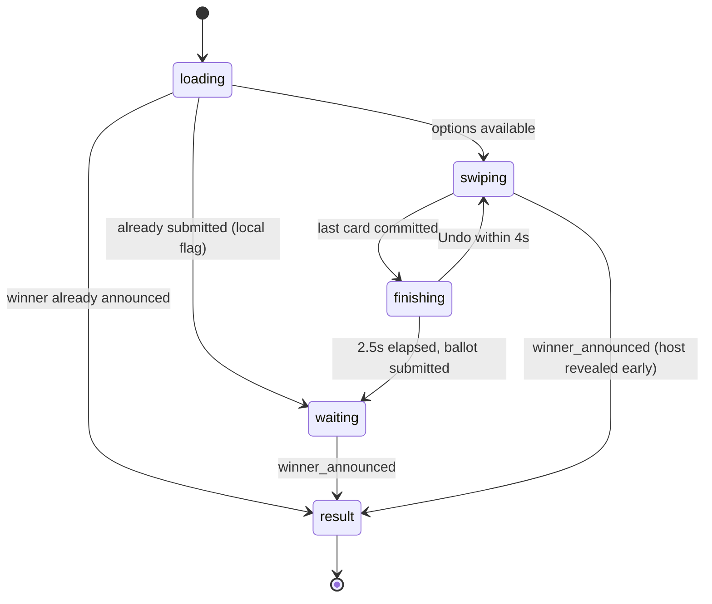

# NoYouPick - Complete Redesign Plan (v2, implementation-ready)

Audience: the engineer or model that will implement this. Everything needed is in this file.
Author intent: a consumer app with mass appeal - warm, obvious, quick, and a little delightful. Not technical, not gimmicky, not "AI-looking".
Status: Plan only. No code has been written for it. Nothing is committed.

---

## Table of contents

- Part A - Rules for the implementer (read first)
- Part B - What the user has told us (requirements from past feedback)
- Part C - Product definition and success targets
- Part D - Experience principles
- Part E - The whole flow as a story
- Part F - Design system (exact tokens)
- Part G - Component specs
- Part H - Screen specs (layout, behavior, states)
- Part I - Copy deck (EN / RO / RU)
- Part J - Data, state and backend contracts
- Part K - Edge cases
- Part L - File plan (delete / create / rewrite)
- Part M - Build tickets in order (with acceptance criteria)
- Part N - QA scripts and definition of done

---

## Part A - Rules for the implementer (read first)

### A.1 Hard constraints

1. **Do not run `git commit`, `git push`, `git reset --hard`, or `git stash drop`.** The owner commits manually after review.
2. Before deleting anything, save the current work: `git diff > ../consensus-engine-pre-redesign.patch` and `git status --porcelain > ../consensus-engine-pre-redesign-files.txt` (outside the repo).
3. **ASCII hyphens only** in code, copy and comments. Never use the characters em dash or en dash. Use `-`.
4. **File size:** every source file <= 400 lines target, 600 hard ceiling.
5. **Design audit must pass:** `node ~/.gemini/config/skills/design-craft/scripts/argon-audit.mjs --target client/src` (zero violations).
6. **Build must pass:** `PATH="/opt/homebrew/bin:$PATH" npm --prefix client run build`.
7. **Lint:** `npm --prefix client run lint` must not get worse.
8. Do not create markdown files anywhere other than `docs/`.
9. Do not touch server files except the ones listed in Part J.6.
10. Never show a number, rating, price, distance or count that is not from real data (Part J.5).
11. Every user-visible string goes through `t()` and exists in all three languages (Part I).

### A.2 Running and testing on a phone

- Backend: `PATH="/opt/homebrew/bin:$PATH" npm --prefix server run start` (port 3000).
- Frontend: `PATH="/opt/homebrew/bin:$PATH" npm --prefix client run dev -- --host 0.0.0.0` (port 5173).
- Phone on the Mac's hotspot or same Wi-Fi: open `http://<mac-ip>:5173`. Get the IP with `ipconfig getifaddr en0` (it changes between networks; previously 172.20.10.2 and 192.168.100.79).
- Multi-user testing: one phone + one normal desktop window + one private desktop window = three participants.

### A.3 Lessons already learned in this codebase (do not regress)

| Lesson | Detail |
|---|---|
| Animated thumbs vs theme transition | `index.css` has `html.theme-transitioning *:not([data-segmented-thumb])` with `!important` transitions. Any element that animates `transform` (segment thumbs, accent picker pill, toggles) **must** carry `data-segmented-thumb="true"` or its animation breaks during theme changes. |
| Centered nav titles | Use the 3-slot pattern: left slot and right slot in normal flow with `z-10`, center content in an `absolute inset-0 flex items-center justify-center pointer-events-none` layer with `pointer-events-auto` on the child. `justify-between` alone is visibly off-center when flanks differ in width. The user noticed this. |
| iOS haptics | iOS Safari has no Vibration API. `utils/haptics.js` uses a hidden `<input type="checkbox" switch>` toggle to trigger the Taptic Engine (iOS 18+). Keep that mechanism (`triggerIosTaptic`). |
| Sound coupled to haptics | Today every `triggerHaptic()` also plays a sound. This is a big part of the "toy" feel. Ticket T3 separates them. |
| Fake progress | `WaitingForBallotsView` auto-advanced after 1.6 s with a fake "Everyone finished". Never auto-advance on a timer. |
| Offline fakery | Join and create flows used to navigate into a mock room when the API failed. Never do this. Show an error with Retry. |

---

## Part B - What the user has told us (treat as requirements)

Collected from the whole conversation. Each item is a requirement, not a suggestion.

| # | Feedback | Requirement it creates |
|---|---|---|
| B1 | "Bento is by far the best" | Home uses a bento-style category grid with photos. |
| B2 | Wanted to clearly see that their own choice is selected / present | Selection and "your stuff" must be visually obvious (selected tile state, "(you)" in lists, your own suggestions marked). |
| B3 | "MOBILE UI IN MIND... fun, interactive, intuitive" | Phone-first. Thumb-reachable primary actions. Gestures with button equivalents. |
| B4 | Safe tumbler, roulette, rotary dial etc. "gimmicky" | No novelty controls. Standard inputs and native-feeling patterns only. |
| B5 | "Less technical looking" | No jargon, no metrics dashboards, no telemetry-looking panels. |
| B6 | "Feels generated by AI", wants "Apple / Linear / Vercel" quality | Strict design system, one accent, real data, restraint, consistent spacing. |
| B7 | "All u did was strip explainer text, thats bad" | Helpful, warm guidance must exist. It lives in context (under headers, under buttons, empty states, first-time hints) rather than marketing blocks. See D.2. |
| B8 | Accent picker: "No need for the names", wanted it animated like Language | Keep accent picker in Settings: swatches only, sliding pill animation. |
| B9 | Segmented controls must animate in Appearance, Accent and Language | All segmented controls use the sliding thumb with the A.3 exemption. |
| B10 | "Start a pick" naming felt off | Plain, everyday wording (Part I). No invented terms. |
| B11 | Noticed off-center header | Pixel accuracy matters. Use A.3 centering pattern everywhere. |
| B12 | Carousel: snap to closest item, with inertia on flicks | Any horizontal photo scroller uses native CSS scroll-snap (`x mandatory`, `scroll-snap-align: center`), which gives momentum and nearest-snap for free. Never JS-reset to a previous item. |
| B13 | Wants to test on iPhone over hotspot | Dev server on `0.0.0.0`, test every ticket on a real phone. |
| B14 | "Do not commit until I say" | See A.1. |
| B15 | Wants "the entire flow" to feel eye-candy and enjoyable, with more options | Delight comes from the flow: friends appearing live, smooth swipe stack, satisfying reveal, easy share. Six categories plus "Your own list" cover breadth without clutter. |

---

## Part C - Product definition and success targets

**What it is:** Friends can't decide where to go. One person picks a category, sends a link, everyone swipes yes/no on the same few places on their own phone, and the app shows the place the group actually likes most.

**Who it is for:** Groups of 2 to 8 friends, couples, coworkers. Mostly on phones, often in a chat app, often in a hurry. Zero patience for setup. No accounts.

**The three moments everything serves:**
1. **Start** - from opening the app to a shareable link in 3 taps and under 10 seconds.
2. **Swipe** - flipping through photos, deciding by gut, no reading required.
3. **Result** - a clear winner, an honest reason, one tap to directions or to tell the group chat.

**Success targets (verify in QA):**

| Metric | Target |
|---|---|
| Host taps from Home to share sheet | 3 (tile -> Start -> Share invite) |
| Guest taps from invite link to "in the group" | 1 to 2 (name if first visit -> Join) |
| Time to swipe 12 cards | under 40 seconds |
| A first-time user completes a vote without asking a question | yes, with 3 of 3 test people |
| Text smaller than 13 px | none |
| Numbers on screen not traceable to data | none |

---

## Part D - Experience principles

### D.1 Principles

1. **One primary action per screen**, always in the bottom third (thumb zone).
2. **Real or nothing.** Missing data is omitted, never invented.
3. **One surface level.** Page background plus content groups. Only sheets, the swipe card and the bottom action bar float.
4. **Plain words.** Two nouns for users to learn: "group" and "code". Everything else is a verb.
5. **Quiet chrome, loud content.** Photos and names carry the screen. UI is neutral plus one accent.
6. **Native over novel.** Large titles, grouped lists, bottom sheets, centered nav titles, share sheet.
7. **Responsive to every touch.** Every tappable thing reacts within 100 ms (press scale), every state change animates briefly, nothing jumps.

### D.2 Guidance without clutter (answers feedback B7)

The app explains itself, but only at the moment the explanation is useful. Four tools, used consistently:

| Tool | Where | Example |
|---|---|---|
| **Intro line** | One line under a screen title, only on Home and Room | Home: "Pick a category. Friends swipe on their phones, and we'll find the place everyone likes." |
| **Section hint** | One footnote line under a section header | Room > Places: "Everyone swipes through these. Tap Edit to swap any out." |
| **What happens next** | Footnote directly under a primary button | Setup: "You'll get a link to send your friends." |
| **First-time hint** | Shown once per device, dismisses itself on first interaction | First swipe card: gentle nudge animation + "Swipe right if you'd go, left if you wouldn't." |
| **Helpful empty/error states** | Whenever a list is empty or something fails | "No group with that code. Check the digits and try again." |

Rules: max one intro line per screen, max one hint per section, all hints 13 px secondary color, never more than 2 lines, never inside cards with borders, never as numbered step ribbons or marketing heroes.

### D.3 Delight list (what makes it enjoyable, all honest)

1. Tapping a category tile: the photo tile compresses slightly, selection haptic, the setup sheet rises with the same photo in its header (visual continuity).
2. Room: friends appear one by one with a soft pop-in; the host feels a light haptic per join.
3. Swipe: physical card stack (next card peeks and grows as you drag), photo paging by tapping left/right edges, fly-off with rotation, instant next card.
4. Undo after any swipe for 4 seconds. Removes fear of mistakes.
5. Waiting: friends' avatars light up as each finishes (real data, backend B1).
6. Result reveal: short staged entrance, success haptic, optional chime (sound off by default). Honest headline variants: "Everyone liked it", "4 of 5 liked it", "Close call with Andy's".
7. Share result into the group chat in one tap with a ready-made message and a directions link.
8. Comes back to you: Home remembers your name, your area, your last picks, and offers "Rejoin" if you left a live group.

---

## Part E - The whole flow as a story

A Friday evening. Alex (host), Ana and Dan (guests).

1. **Alex opens the app.** Home shows "What's the plan?" with one intro line and the photo bento: Food (wide), Coffee, Drinks, Cinema, Dessert, and "Your own list" (wide, no photo). Below: "Join with a code". If Alex has history, a "Recent" section shows the last pick.
2. **Alex taps Food.** Selection haptic. A sheet rises: header shows the Food photo and "Where are we eating?". Rows: Near (Chisinau center, or "Use my location"), Price (Any / $ / $$ / $$$), and Your name (only if never entered). Sticky "Start" button with "You'll get a link to send your friends." under it.
3. **Alex taps Start.** The button shows a spinner and "Finding places...". The real API creates the room and returns places. The sheet dismisses into the Room screen.
4. **Room screen.** Title "Where are we eating?". Big code "4821", "Invite your friends", hint "They open the link or enter this code. No app or account needed." Primary "Share invite" opens the native share sheet with: "Help me pick where we eat - tap to vote: https://.../r/4821". Below: People (Alex (you)), Places (12) as a photo strip with Edit. Bottom bar: "Start voting" with "Just you so far. You can start anyway."
5. **Ana taps the link in the chat.** First visit: a small sheet "What should we call you?" -> "Ana" -> Join. She sees the Room as a guest: same code, people, places, and at the bottom "Alex will start the vote soon". On Alex's phone Ana pops in with a light haptic.
6. **Dan joins with the code** from Home -> "Join with a code" -> types 4821 (auto-submits on the 4th digit) -> name -> in.
7. **Alex taps Start voting.** All three phones move to the swipe screen at once.
8. **Swiping.** "1 of 12" centered on top. First-ever card: a gentle nudge and the hint "Swipe right if you'd go, left if you wouldn't." Big photo, name, "Pizza · 1.2 km · $$". Pass and Like buttons below. Tap the card body for details (photos, address, map, hours if known). Undo appears for 4 s after each swipe.
9. **Ana finishes first.** She sees "You're done", three avatars with hers lit, "1 of 3 done". Dan finishes, his avatar lights.
10. **Alex finishes.** Everyone has voted, so the server resolves. All screens show the reveal: "Your group picked", big photo of Andy's Pizza, "Everyone liked it", "Directions" and "Share". Below: "Also liked" with two runner-ups and their real like counts. "New vote" at the bottom.
11. **Alex taps Share** -> "We're going to Andy's Pizza! Picked together on NoYouPick." + maps link -> group chat. Done in under 2 minutes total.
12. **Next week** Alex opens the app: "Recent: Andy's Pizza · 3 people · Fri". History holds all past picks.

---

## Part F - Design system (exact tokens)

Implement as CSS variables in `client/src/index.css` under `:root` (light) and `html.dark` (dark) - follow the existing theme mechanism in `ThemeContext.jsx`. Expose them to Tailwind via `@theme` so classes like `bg-surface` or `text-secondary` work. After this, screens must not contain raw hex values, `text-[Npx]`, or arbitrary shadows.

### F.1 Color

| Token | Light | Dark | Use |
|---|---|---|---|
| `--bg` | `#F7F5F0` | `#111113` | Page background |
| `--surface` | `#FFFFFF` | `#1C1C1F` | Grouped list rows, sheets, cards |
| `--surface-2` | `#EFECE6` | `#26262A` | Inputs, secondary buttons, skeletons, pressed rows |
| `--separator` | `rgba(60,60,67,0.18)` | `rgba(255,255,255,0.10)` | Hairlines (0.5 px on retina, 1 px otherwise) |
| `--label` | `#1C1B19` | `#F5F4F1` | Primary text |
| `--label-2` | `rgba(28,27,25,0.64)` | `rgba(245,244,241,0.64)` | Secondary text |
| `--label-3` | `rgba(28,27,25,0.42)` | `rgba(245,244,241,0.40)` | Placeholders, disabled |
| `--accent-fill` | `#D33A2B` | `#D33A2B` | Primary button background, Like button (white text on it passes 4.5:1) |
| `--accent-fill-pressed` | `#B93021` | `#B93021` | Pressed primary |
| `--accent-text` | `#C93526` | `#FF6B5D` | Links, selected labels, accent icons on neutral surfaces |
| `--accent-soft` | `rgba(211,58,43,0.12)` | `rgba(255,107,93,0.16)` | Selected tile ring halo, selected row tint |
| `--destructive` | `#D92D20` | `#FF5A4F` | Destructive rows only |
| `--scrim` | `rgba(0,0,0,0.40)` | `rgba(0,0,0,0.55)` | Sheet backdrop |
| `--photo-scrim` | linear-gradient to top, `rgba(0,0,0,0.62)` 0% -> `rgba(0,0,0,0)` 55% | same | Text-over-photo legibility only |

Accent picker (B8) swaps the three accent tokens. Each accent option must define fill/pressed/text/soft and pass 4.5:1 for white text on fill. Keep the existing palette but recompute those four values per option; drop any option that can't pass.

Removed from UI: emerald, amber, indigo, rose, violet, cyan. No pure black `#000000`.

### F.2 Typography

Font stack (keep): `-apple-system, BlinkMacSystemFont, "SF Pro Text", "Inter", system-ui, sans-serif`. Use `font-variant-numeric: tabular-nums` for codes, counts and progress.

| Token | Size / line-height | Weight | Letter-spacing | Use |
|---|---|---|---|---|
| `text-large-title` | 32 / 38 | 700 | -0.4px | One per screen max (Home, History, Room code uses `text-code`) |
| `text-title` | 22 / 28 | 700 | -0.2px | Card name, winner name, sheet title |
| `text-headline` | 17 / 22 | 600 | -0.2px | Row titles, button labels, nav title |
| `text-body` | 17 / 22 | 400 | -0.2px | Inputs, body copy |
| `text-subhead` | 15 / 20 | 400 | 0 | Secondary row text, intro lines |
| `text-footnote` | 13 / 18 | 400 | 0 | Hints, meta lines, captions. Minimum size in app. |
| `text-code` | 56 / 60 | 700 | 4px | Room code display only |

Rules: no uppercase labels with letter-spacing; no text below 13 px; at most two weights visible per screen region; section headers are `text-footnote` weight 600 in `--label-2`, sentence case.

### F.3 Spacing and layout

- Scale: 4, 8, 12, 16, 20, 24, 32, 40. Nothing else.
- Screen horizontal padding: 16 px (20 px when viewport >= 390 px).
- Section gap: 24 px. Header-to-content gap inside a section: 8 px.
- Content max width: 480 px, centered.
- Bottom action bar height: 56 px button + 12 px top padding + `max(12px, env(safe-area-inset-bottom))`.
- All tap targets >= 44 x 44 px.

### F.4 Radius, borders, elevation

| Token | Value | Use |
|---|---|---|
| `--r-sm` | 10 px | Inputs, small buttons, chips |
| `--r-md` | 16 px | Tiles, list groups, thumbnails >= 64 px |
| `--r-lg` | 28 px | Sheets (top corners), swipe card, result photo |
| `full` | 9999 px | Avatars, circular icon buttons, Like/Pass |

- Borders: none on content groups. Use `--surface` on `--bg` for separation and `--separator` hairlines between rows.
- Shadows (only three, nothing else):
  - `--shadow-card`: `0 12px 32px rgba(17,17,19,0.18)` (swipe card, result photo)
  - `--shadow-sheet`: `0 -8px 40px rgba(17,17,19,0.22)` (sheets)
  - `--shadow-bar`: `0 -1px 0 var(--separator)` (bottom action bar; a hairline, not a glow)
- Nesting: maximum one container level. Never a bordered box inside a bordered box.
- The bottom action bar uses `--bg` at 85% opacity with `backdrop-filter: blur(20px) saturate(180%)`.

### F.5 Iconography and imagery

- Icons: `lucide-react` only, stroke width 2, sizes 20 (default) or 24 (vote buttons, nav). Icons in `--label-2` unless accent-selected.
- Category photos: local files in `client/public/categories/` (see T13), WebP, max 1200 px wide, max 140 KB each, same warm color treatment, no hotlinking.
- Venue photos: edge to edge, `object-fit: cover`, `--photo-scrim` only behind text.
- No emoji in UI chrome. No illustrations with mixed styles. No gradients as decoration.

### F.6 Motion

| Token | Duration | Easing | Use |
|---|---|---|---|
| `--ease-out` | - | `cubic-bezier(0.2, 0.8, 0.2, 1)` | Default |
| `--ease-sheet` | - | `cubic-bezier(0.32, 0.72, 0, 1)` | Sheet open/close (iOS-like) |
| `--ease-spring` | - | `cubic-bezier(0.34, 1.4, 0.64, 1)` | Card return, pop-ins |
| `--ease-in` | - | `cubic-bezier(0.5, 0, 0.75, 0)` | Card fly-off, exits |
| `--d-press` | 100 ms | ease-out | Press scale to 0.97 |
| `--d-fast` | 160 ms | ease-out | Fades, color changes |
| `--d-base` | 240 ms | ease-out | Segment thumb, list item enter |
| `--d-sheet` | 380 ms | ease-sheet | Sheet enter; exit 260 ms |
| `--d-card-return` | 320 ms | ease-spring | Card snaps back |
| `--d-card-out` | 260 ms | ease-in | Card flies off |

Specific behaviors:
- **Press:** every tappable scales to 0.97 on pointer down, back on up. Rows also darken to `--surface-2`.
- **List enter:** opacity 0 -> 1 and translateY 8 px -> 0, 240 ms, stagger 40 ms, max 6 items staggered.
- **Pop-in (person joins):** scale 0.6 -> 1 with `--ease-spring`, 320 ms.
- **No looping animations** except a spinner during a real network wait. No pulse, ping, shimmer-forever, bounce.
- **Reduced motion** (`prefers-reduced-motion: reduce`): replace all transforms with 160 ms opacity fades; swipe still follows the finger but fly-off becomes a fade.

### F.7 Haptics and sound map

Haptics on by default (toggle "Vibration"). Sounds **off by default** (toggle "Sounds"). After T3 they are independent.

| Event | Haptic type (existing) | Sound (only if Sounds on) |
|---|---|---|
| Category tile tap | `selection` | none |
| Segmented control change | `selection` | none |
| Card committed Like | `like` | `playSwipeRightSound` |
| Card committed Pass | `pass` | `playSwipeLeftSound` |
| Undo | `selection` | none |
| Friend joined (host only) | `light` | none |
| Result revealed | `match` | `playMatchChime` |
| Error (wrong code, failure) | `pass` (single firm tap) | none |
| Everything else | none | none |

Remove `veto` and `superlike` usage.

---

## Part G - Component specs

All components live in `client/src/components/ui/` unless noted, consume tokens only, and have no business logic.

### G.1 `Screen`
- Props: `children`, `bottomBar?: ReactNode`, `scroll = true`.
- Renders full-height (`min-h-[100dvh]`) column on `--bg`, top padding `env(safe-area-inset-top)`, horizontal padding per F.3, max width 480 centered. If `bottomBar` is given, renders it fixed at bottom with F.4 bar styling and adds matching bottom padding to content so nothing hides behind it.

### G.2 `NavBar`
- Props: `left?: ReactNode`, `title?: ReactNode`, `right?: ReactNode`, `progress?: number (0..1)`.
- Height 44 px. Uses the A.3 three-slot centering pattern. Title `text-headline`, truncates with ellipsis, max width = 100% minus 2 x 88 px.
- Optional 2 px progress line at the very bottom in `--accent-fill`, width animated with `--d-base`.
- Standard left buttons: `NavBackButton` (chevron-left + label) and `NavCloseButton` (X in a 32 px `--surface-2` circle). Right: `NavIconButton` (32 px circle).

### G.3 `LargeTitle`
- Props: `title`, `intro?`. Title `text-large-title`, intro `text-subhead` `--label-2`, 8 px gap, max 2 lines for intro.

### G.4 `Button`
- Props: `variant: 'primary' | 'secondary' | 'plain' | 'destructive'`, `size: 'lg' | 'md'`, `loading?`, `loadingLabel?`, `disabled?`, `icon?`, `fullWidth?`.
- `lg` = 56 px high, `md` = 44 px. Radius `--r-md` for lg, `--r-sm` for md.
- primary: `--accent-fill`, white `text-headline`. secondary: `--surface-2`, `--label`. plain: transparent, `--accent-text`. destructive: plain style in `--destructive`.
- Loading: spinner (18 px) replaces icon, label becomes `loadingLabel` if given, button stays same width, `aria-busy`.
- Disabled: 40% opacity, no press scale.
- Remove current specular inset highlights and glow shadows.

### G.5 `Sheet`
- Props: `open`, `onClose`, `title?`, `header?: ReactNode` (e.g. photo), `footer?: ReactNode` (sticky actions), `detent: 'auto' | 'large'`, `children`.
- Implementation option 1 (preferred): `vaul` Drawer (verify React 19 peer support at install time; if peer conflicts, use option 2).
- Option 2 (custom): portal to `body`; backdrop `--scrim` fade `--d-fast`; panel slides from translateY(100%) with `--d-sheet`; top radius `--r-lg`; grabber 36 x 5 px, `--label-3`, 8 px from top; max height 92dvh; `auto` detent sizes to content; content scrolls internally; footer sticky with safe-area bottom padding.
- Drag to dismiss: drag from grabber/header (or anywhere when content scrollTop = 0). Panel follows finger 1:1 downward, resists upward (0.2x). Release dismisses if dragged > 25% of panel height or velocity > 0.5 px/ms; otherwise springs back with `--ease-spring`.
- Esc closes, focus is trapped and restored, body scroll locked while open, `role="dialog"` + `aria-modal` + labelled by title.

### G.6 `ListGroup` and `Row`
- `ListGroup` props: `header?`, `hint?` (footnote under the group), `children`. Renders header (F.2 section header style, 16 px horizontal inset), then a `--surface` block with `--r-md` radius, then hint.
- `Row` props: `leading?` (icon 28 px tinted square or thumbnail), `title`, `subtitle?`, `trailing?` (value text, chevron, toggle, segmented), `onClick?`, `destructive?`, `selected?`.
- Row min height 52 px, 16 px horizontal padding, hairline separator inset from the text start (not under the leading icon), last row has no separator. Pressable rows get the press state.

### G.7 `SegmentedControl` (restyle existing)
- Keep the sliding thumb and `data-segmented-thumb="true"`. Track `--surface-2`, thumb `--surface` with `0 1px 3px rgba(17,17,19,0.12)`, radius 9 px inside a 10 px track, label `text-subhead` weight 600 when selected. Height 36 px. Thumb moves with `--d-base` `--ease-out`.

### G.8 `Toggle` (restyle `SpringToggle`)
- iOS switch: 51 x 31 px, on = `--accent-fill`, knob white with small shadow, thumb animation tagged `data-segmented-thumb`.

### G.9 `CategoryTile` (in `components/home/`)
- Props: `title`, `subtitle`, `image?`, `icon`, `wide?`, `onPress`.
- Photo variant: radius `--r-md`, image cover, `--photo-scrim`, text bottom-left 16 px inset: title `text-headline` white, subtitle `text-footnote` white 80%. Heights: wide 152 px, normal 128 px.
- Plain variant (no image, for "Your own list"): `--surface`, 64 px high, leading 36 px `--accent-soft` circle with icon in `--accent-text`, title + subtitle, trailing chevron.
- Press: scale 0.97 + selection haptic. If an image fails to load, fall back to `--surface-2` with the icon centered (no broken image).

### G.10 `CodeDisplay` (in `components/room/`)
- Props: `code`, `onCopy`.
- Four digits in `text-code`, tabular, `--label`, centered. Whole block is a button: tap copies the invite link, the caption under it swaps from "Tap to copy link" to "Copied" for 1.5 s with a crossfade. No toast.

### G.11 `CodeInput` (in `components/home/`)
- Four 56 x 64 px boxes, `--surface-2`, radius `--r-sm`, digit `text-title` tabular. Active box gets a 2 px `--accent-fill` ring. Auto-advance, backspace goes back, paste of 4 digits fills all, `inputMode="numeric"`, `autocomplete="one-time-code"`. When 4 digits present, calls `onComplete(code)` automatically.
- Error state: horizontal shake (3 cycles, 6 px, 300 ms) + boxes tinted `--destructive` for 600 ms + error haptic.

### G.12 `Avatar` and `AvatarStack`
- Avatar: circle with initials (first letter of first two words), `text-subhead` weight 600, background chosen deterministically from 6 muted neutral-warm tones (defined as tokens `--avatar-1..6`, all low saturation), sizes 28 / 36 / 48. Props `name`, `size`, `dimmed?` (40% opacity), `ring?` (2 px `--accent-fill` ring for "done").
- AvatarStack: overlapping by 8 px, max 5 then "+N" bubble.

### G.13 `PlaceRow` (in `components/room/`)
- Thumbnail 56 px `--r-sm`, title `text-headline`, subtitle `text-footnote` meta line (Part J.4 rules), optional trailing (count text like "3 likes", remove button, chevron).

### G.14 `EmptyState`, `InlineError`, `Banner`, `Skeleton`, `Spinner`
- EmptyState: 48 px icon in `--label-3`, title `text-headline`, body `text-subhead` `--label-2` max 2 lines, optional Button md secondary. Centered with 40 px vertical padding.
- InlineError: row with alert icon in `--destructive`, message `text-subhead`, trailing plain button "Try again".
- Banner: full-width strip under NavBar, `--surface-2`, `text-footnote`, for "Reconnecting...". Slides down `--d-fast`. No color coding, no ping dot.
- Skeleton: `--surface-2` blocks matching final shapes, static (no shimmer).
- Spinner: 18/24 px, 2 px stroke ring, `--label-3` track and current-color head, rotates 800 ms linear. Only during real waits.

### G.15 Vote components (in `components/vote/`)
- `CardStack`, `SwipeCard`, `VoteButtons`, `UndoChip`, `SwipeHint`, `PlaceDetailsSheet` - see H.6.

---

## Part H - Screen specs

Copy keys in brackets refer to Part I.

### H.1 Home (`/`)

**Purpose:** start a group in one tap, or join one.

**Layout top to bottom**
1. `NavBar`: left = logo mark (24 px) + "NoYouPick" `text-headline`; right = `NavIconButton` gear -> Settings sheet. No theme toggle, no history icon.
2. 8 px gap.
3. **Rejoin banner** (only if `consensus_active_pin` is set and `GET /api/v1/rooms/:pin` says the room is open): a `--surface` row with radius `--r-md`: title [home.rejoinTitle], subtitle = room topic, trailing Button md primary [home.rejoin]. Tapping X on the row clears the key.
4. `LargeTitle` title [home.title], intro [home.intro].
5. 20 px gap. **Bento grid** (2 columns, 12 px gap):
   - Row 1: Food (wide, photo)
   - Row 2: Coffee | Drinks (photos)
   - Row 3: Cinema | Dessert (photos)
   - Row 4: Your own list (wide, plain variant)
6. 16 px gap. Button lg secondary full width, icon `KeyRound`, label [home.join] -> Join sheet.
7. 24 px gap. **Recent** (only if history exists): `ListGroup` header [home.recent] with trailing plain link [home.seeAll] -> `/history`; up to 2 `PlaceRow`s (winner photo, winner name, footnote "Food · 3 people · Fri"). Tap -> History detail.

**Behavior**
- Tile tap -> open `SetupSheet` with that category.
- If arriving with `/?pin=1234` (legacy links), redirect to `/r/1234`.

**States**
- First launch: same layout, no Recent, no Rejoin.
- Offline: grid works; errors appear inside the Setup sheet when starting.

### H.2 Setup sheet (from a tile)

**Header:** 120 px tall photo of the category (plain variant shows icon on `--surface-2`), with `--photo-scrim` and the room topic on it in `text-title` white, for example [topic.food] "Where are we eating?". Close button top-right (32 px circle, white icon on 30% black).

**Discovery categories (Food, Coffee, Drinks, Cinema, Dessert)**
- `ListGroup`:
  - Row "Near" [setup.near]: trailing value = area label (for example "Chisinau center") + chevron -> `LocationSheet`. If location permission is already granted (check `navigator.permissions.query({name:'geolocation'})` where supported), silently use GPS and show the reverse-geocoded label. If not granted, show the saved or default area and a second line plain button [setup.useMyLocation] that requests permission.
  - Row "Price" [setup.price]: trailing `SegmentedControl` [price.any] / $ / $$ / $$$ (width 200 px).
  - Row "Your name" [setup.name] - only if no stored name: inline text input, placeholder [setup.namePlaceholder], max 24 chars.
- Footer (sticky): Button lg primary full width [setup.start], loading label [setup.finding]; footnote [setup.startHint] centered under it.

**Your own list**
- `ListGroup` header [setup.questionHeader]: one text input, placeholder rotates every 3 s between [setup.qExample1..3] (fade), max 80 chars, autofocus when the sheet opens.
- `ListGroup` header [setup.optionsHeader], hint [setup.optionsHint]: list of added options as rows with a remove button (minus circle), last row is an inline input "Add option" [setup.addOption] with return-to-add. Below the group, a horizontal scroll of quick-idea chips (existing `starterIdeas` logic, restyled as `--surface-2` chips, radius `--r-sm`, `text-subhead`) - tap adds.
- Name row as above if needed.
- Footer: [setup.start], disabled until question has >= 2 characters; footnote [setup.startHintCustom].

**Start behavior**
1. Save name to `consensus_user_name`.
2. `POST /api/v1/rooms` with the existing body shape (`host_id`, `mode`, `theme`, `radius: 5000`, `latitude`, `longitude`, `deck_size: 12`). Theme values must stay exactly as today: Food `restaurants`, Coffee `cafes`, Drinks `bars & pubs`, Cinema `cinema`, Dessert `desserts`, custom mode uses the question.
3. On success: store host flags/token exactly as today (`consensus_host_<pin>`, `consensus_host_token_<pin>`, `consensus_active_pin`), apply the price filter (J.4) to returned options, close sheet, navigate to `/r/<pin>` with `{ isHost: true, options, topic, mode, category, initialCustomOptions }` in router state.
4. Loading: after 8 s, footnote changes to [setup.stillLooking]. After 20 s or on error: `InlineError` [error.generic] or [error.offline] above the button, button returns to normal. **Never** fall back to mock data.

### H.3 Location sheet (rename `UberLocationSearchModal` -> `LocationSheet`)
- Title [location.title]. Search field (`--surface-2`, radius `--r-sm`, magnifier icon) placeholder [location.placeholder], debounce 300 ms using existing `searchLocationByQuery`.
- First row: [location.current] with location icon -> `detectUserGps({ forceRefresh: true })`.
- Then results as rows (title = place name, subtitle = locality). Then `POPULAR_LOCATIONS` under header [location.popular] when the search is empty.
- Selecting closes the sheet and updates the Near row with a crossfade.
- Permission denied: footnote [location.denied] with the default city name.

### H.4 Join sheet and Name sheet

**Join sheet** (from Home "Join with a code")
- Title [join.title], hint [join.hint]. `CodeInput` autofocused.
- On complete: `GET /api/v1/rooms/:code`.
  - 404: error state on CodeInput + footnote [join.notFound]; clear digits after 600 ms and refocus.
  - Network error: `InlineError` [error.offline].
  - OK and name stored: navigate to `/r/<code>`.
  - OK and no name: the sheet content crossfades to the name step: title [join.nameTitle], input, Button lg primary [join.join].

**Name sheet** (shown over Room when arriving by link without a stored name)
- Title [join.nameTitle], hint [join.nameHint], input autofocused, Button lg primary [join.join]. Cannot be dismissed by drag until a name is entered (prevents nameless "Guest"). A plain "Cancel" goes Home.

### H.5 Room (`/r/:code`)

**Purpose:** get friends in. For the host, also a quick check of what will be voted on.

**Layout (host, discovery mode)**
1. `NavBar`: left `NavCloseButton` -> leave confirm (H.5 leave); title = topic; right none.
2. 16 px gap. Centered block:
   - `CodeDisplay` with caption [room.tapToCopy] / [room.copied].
   - 8 px. Title [room.inviteTitle] `text-headline`, hint [room.inviteHint] `text-footnote` `--label-2`, centered, max width 300 px.
   - 16 px. Two buttons in a row: Button lg primary [room.share] with `Share` icon (flex 1) and a 56 px secondary square button with `QrCode` icon -> QR sheet (restyled `QrCodeModal` as a Sheet: QR on white, the code under it, footnote [room.qrHint]).
3. 32 px gap. `ListGroup` header "[room.people] · N": one row per participant: Avatar 36 + name; your row has suffix [room.you] in `--label-2`; host row has subtitle [room.hostLabel]. New rows pop in. Rows for people who leave fade out.
4. 24 px gap. `ListGroup` header "[room.places] · N", trailing plain [room.edit] -> Places sheet, hint [room.placesHint]: content is a horizontal scroller (scroll-snap x mandatory, 12 px gap, 16 px side padding) of 104 x 132 px place thumbnails (photo top 104 px square radius `--r-sm`, name `text-footnote` 2 lines). Tap a thumbnail -> `PlaceDetailsSheet` (view only, no vote buttons).
5. Bottom bar: Button lg primary full width [room.startVoting]. Footnote above it (inside the bar, 8 px): [room.aloneHint] if only the host is present; nothing otherwise. Disabled with footnote [room.needTwo] if fewer than 2 places.

**Layout (guest, discovery mode)**
- Same 1 to 4, but no Edit and no Share button? **Keep Share** (guests often forward the link) as secondary variant. Bottom bar shows a static row (no button): Avatar of host 28 px + text [room.guestWaiting] with `{name}` = host name. No spinner.

**Custom mode differences**
- Places section becomes `ListGroup` header "[room.options] · N" with rows (option name, subtitle "[room.addedBy] {name}" if suggested by someone). Your own suggestions show a small "(you)" and a remove button; host can remove any.
- Last row is an inline input [room.suggestPlaceholder] with an add button, for everyone. Uses existing `add_suggestion` / `remove_suggestion` socket events and the existing autocomplete (restyled as a simple dropdown list of rows).
- Empty: hint [room.customEmpty].

**Leave confirm** (NavCloseButton): native-style action sheet (Sheet with two buttons): title [room.leaveTitle], body [room.leaveBody], Button destructive [room.leave], Button secondary [common.cancel]. Leaving emits `leave_lobby`, clears `consensus_active_pin`, navigates Home.

**States**
- Joining/loading: skeleton code (4 grey blocks), skeleton rows. If `room_error` "not found": full-screen `EmptyState` [room.endedTitle] / [room.endedBody] with [common.home].
- Reconnecting: `Banner` [room.reconnecting] after 1.2 s of disconnect, hidden on reconnect.
- `lobby_closed`: same as ended.
- Host leaves: server reassigns `host_id`; if you become host, show the host bottom bar and a one-time footnote [room.nowHost].
- `voting_started` received: navigate everyone to `/r/<code>/vote` with options in state.

### H.6 Vote (`/r/:code/vote`) - one route, four states

State machine (implement in `useVoting`):



#### H.6.1 Swiping

**Layout**
1. `NavBar`: left `NavCloseButton` -> leave confirm (same as Room but body [vote.leaveBody]); title [vote.progress] "3 of 12" tabular; right none; `progress` = index / total.
2. `CardStack` fills the remaining height between nav and buttons (min 360 px, max 620 px, width 100% up to 440 px, 16 px side padding).
   - Top card: `SwipeCard`. Behind it: next card at scale 0.94, translateY 12 px, no shadow. The card after that is not rendered.
   - As the top card is dragged, the next card interpolates toward scale 1 / translateY 0 proportionally to drag progress (0 -> 1 at commit threshold).
3. `VoteButtons`: 24 px below the stack. Two 68 px circles, 56 px apart, centered: Pass (`--surface`, `X` icon 28 px `--label`, `--shadow-card` at 40% strength) and Like (`--accent-fill`, `Heart` icon 28 px white, filled). Labels under each: [vote.pass] / [vote.like] `text-footnote` `--label-2`.
4. `UndoChip`: appears centered 12 px above the buttons for 4 s after each commit: `--surface` pill, `RotateCcw` icon + [vote.undo]. Tapping restores the previous card (reverse fly-in from the side it left, 260 ms) and removes that vote.

**SwipeCard content**
- Photo fills the card (radius `--r-lg`, `--shadow-card`). Photo paging: tap left 30% of the photo = previous photo, right 30% = next photo; page indicator = thin segments at the top (like Stories), 3 px tall, 4 px gap, white 40% / 100%.
- Bottom overlay on `--photo-scrim`: name `text-title` white (2 lines max), meta line `text-subhead` white 85% (J.4).
- Middle 40% of the photo (and the text area) tap -> `PlaceDetailsSheet` with vote buttons.
- Custom options: if a poster/photo resolves (existing `useCustomOptionPhoto`), use it; otherwise a typographic card: `--surface` with the option name centered in `text-large-title`, and the question in `text-footnote` `--label-2` above it.
- Missing photo for a venue: `--surface-2` with the category icon 48 px and the name - never a broken image.

**Gesture spec**
- Pointer events on the card with `touch-action: none` (pan-y allowed only inside the details sheet).
- Card translates 1:1 with the finger; rotation = dx x 0.05 deg (max 12 deg); slight lift (scale 1.02) while dragging.
- Feedback while dragging: a corner label pill appears (top-left "Like" in `--accent-fill` with white text when dragging right; top-right "Pass" in `--surface` when dragging left), opacity mapped from 15% to 35% of card width. No rotated stamps, no icons.
- Commit if |dx| > 30% of card width OR horizontal velocity > 0.5 px/ms in the drag direction. Otherwise spring back (`--d-card-return`).
- On commit: card flies off to 1.5x viewport width in the drag direction, continuing rotation, `--d-card-out`; haptic per F.7; next card is already in place.
- Buttons trigger the same fly-off animation programmatically.
- Keyboard (desktop): ArrowRight = Like, ArrowLeft = Pass, Backspace/Z = Undo, Space = open details.
- Vertical drags do nothing (no up/down actions).

**First-time hint** (`nyp_seen_swipe_hint` not set): 600 ms after the first card appears, the card nudges right 28 px, back, left 28 px, back (900 ms total, `--ease-out`), and `SwipeHint` text [vote.hint] fades in above the buttons. Both disappear on the first touch or after 6 s; set the flag then.

**Preloading:** preload the photos of the next 2 cards (`new Image().src`).

**Votes:** stored locally as `{ option_id, score }` where Like = 1, Pass = -1. No other scores.

#### H.6.2 Finishing
- After the last commit: show a centered `EmptyState`-style block "All swiped" [vote.allSwiped] with the UndoChip still available for 2.5 s, then emit `submit_ballot` `{ pin, participant_id, rankings }` (existing contract), set local flag `nyp_submitted_<pin>`, go to Waiting.

#### H.6.3 Waiting
- Center column: `AvatarStack` of all participants at 48 px: finished = full opacity + accent ring; not finished = dimmed. (Requires backend B1. If `voted_participant_ids` is absent, show the stack without per-person state.)
- Title [waiting.title] `text-title`. Line [waiting.progress] "2 of 4 done" from `vote_progress`.
- Hint [waiting.hint].
- Host only: Button md plain [waiting.revealNow] -> `host_force_reveal` with host token (existing). Shown only once at least 1 ballot exists.
- Never auto-advance on a timer. Only `winner_announced` moves to Result.

#### H.6.4 Result
**Reveal sequence:** eyebrow fades in (0 ms), photo card scales 0.96 -> 1 and fades in (120 ms delay, 420 ms `--ease-spring`), name and reason fade up (280 ms delay), buttons fade up (400 ms delay). Haptic `match`, chime if Sounds on.

**Layout**
1. `NavBar`: left `NavCloseButton` -> Home (no confirm; clears active pin); title none.
2. Eyebrow [result.eyebrow] `text-footnote` weight 600 `--label-2`, centered.
3. Winner photo: full width, aspect 4:3, radius `--r-lg`, `--shadow-card`. Tap -> `PlaceDetailsSheet` (no vote buttons).
4. Name `text-title`, centered. Meta line (J.4) `text-subhead` `--label-2`.
5. Reason line `text-subhead` weight 600 in `--accent-text`, one of (from backend B2 data):
   - all voters liked it -> [result.everyone]
   - else -> [result.likedBy] "{n} of {total} liked it"
   - plus, if the runner-up has the same like count -> second line [result.closeCall] "Close call with {name}" in `--label-2`.
6. Buttons: Button lg primary [result.directions] (icon `Navigation`) full width; below it Button lg secondary [result.share] (icon `Share`).
   - Directions: iOS -> `https://maps.apple.com/?daddr=<lat>,<lng>&q=<name>`; other -> `https://www.google.com/maps/dir/?api=1&destination=<lat>,<lng>`; no coordinates -> search URL by name + address. Custom-mode winners have no Directions; Share becomes primary.
   - Share: `navigator.share({ text: [result.shareText], url: directionsUrl })`; fallback copy to clipboard and swap the label to [room.copied] for 1.5 s.
7. 24 px. `ListGroup` header [result.alsoLiked]: up to 3 `PlaceRow`s from the tally (likes > 0, excluding winner), trailing "[result.likes] {n}". Hidden if none.
8. Button md plain [result.newVote] -> Home.
9. Once per device, iOS Safari not in standalone mode: a `Row` [result.install] with trailing chevron that opens a small sheet explaining Share -> Add to Home Screen (reuse `InstallPrompt` logic). Set `nyp_install_hint_seen`.

**Nobody liked anything** (approval count 0): replace 3 to 7 with `EmptyState` [result.nobodyTitle] / [result.nobodyBody], host gets Button lg primary [result.tryAgain] -> Home with the Setup sheet reopened for the same category; guests get [result.newVote].

**History write:** on first render of a resolved result, upsert by pin into `consensus_history` (J.3), keep the last 30.

### H.7 Place details sheet
- Detent large. Header: horizontal photo scroller (scroll-snap center, momentum, B12), 240 px tall, page dots below.
- Title `text-title`, meta line, then `ListGroup` rows only for fields that exist: Address (trailing "Directions" plain), Hours, Phone (tel link), Website (opens new tab). Then the existing `CleanStreetMiniMap` (radius `--r-md`) if coordinates exist.
- Bottom (plain destructive, small): [details.reportClosed] -> existing report endpoint -> row text swaps to [details.reported].
- When opened from Swipe: sticky footer with Pass / Like buttons (Button lg secondary / primary, side by side). Choosing closes the sheet and commits with the normal animation.

### H.8 History (`/history`)
- `NavBar` left `NavBackButton` [common.back]. `LargeTitle` [history.title].
- Groups: [history.thisWeek], [history.earlier]. Rows: `PlaceRow` thumbnail, winner name, footnote "Food · 3 people · Oct 18" (localized date via `Intl.DateTimeFormat(lang, { month: 'short', day: 'numeric' })`).
- Swipe a row left to reveal Delete (80 px `--destructive` area) - or long-press menu fallback on desktop: trailing `...` button with Delete.
- Tap -> read-only result layout (H.6.4 without reveal animation, without "New vote", NavBar back).
- Empty: `EmptyState` [history.emptyTitle] / [history.emptyBody], Button [history.emptyAction] -> Home.

### H.9 Settings sheet
- Title [settings.title], trailing plain [common.done].
- `ListGroup` [settings.appearance]: Row with full-width `SegmentedControl` [settings.system] / [settings.light] / [settings.dark] (icons Laptop / Sun / Moon). Row [settings.color] with the accent picker below (swatches only, sliding pill, B8).
- `ListGroup`: Row [settings.language] with trailing `SegmentedControl` English / Romana / Russkiy (display names: "English", "Română", "Русский").
- `ListGroup`: Row [settings.vibration] with Toggle; Row [settings.sounds] with Toggle (default off).
- `ListGroup`: Row [settings.history] chevron -> `/history`; Row [settings.clearHistory] destructive -> confirm sheet [settings.clearConfirm] with Button destructive [settings.clear] and [common.cancel].
- Footer footnote: "NoYouPick" + version from `package.json`.
- No toasts on any change. Changes apply instantly.

---

## Part I - Copy deck (EN / RO / RU)

Rules: sentence case; no exclamation marks except [result.shareText]; never use "consensus", "ballot", "quorum", "lobby", "deck", "PIN", "pick" as a noun for the session. Plurals are avoided by design ("2 of 4 done", "People · 3"), so only `{var}` interpolation is needed (T4).

| Key | EN | RO | RU |
|---|---|---|---|
| common.back | Back | Înapoi | Назад |
| common.cancel | Cancel | Anulează | Отмена |
| common.done | Done | Gata | Готово |
| common.home | Back to home | Înapoi acasă | На главную |
| common.retry | Try again | Încearcă din nou | Повторить |
| home.title | What's the plan? | Ce facem? | Какие планы? |
| home.intro | Pick a category. Friends swipe on their phones, and we'll find the place everyone likes. | Alege o categorie. Prietenii dau swipe pe telefon, iar noi găsim locul care le place tuturor. | Выберите категорию. Друзья свайпают на своих телефонах, а мы найдём место, которое понравится всем. |
| home.join | Join with a code | Intră cu un cod | Войти по коду |
| home.recent | Recent | Recente | Недавние |
| home.seeAll | See all | Vezi tot | Все |
| home.rejoinTitle | You're still in a group | Încă ești într-un grup | Вы всё ещё в группе |
| home.rejoin | Rejoin | Revino | Вернуться |
| cat.food | Food | Mâncare | Еда |
| cat.foodSub | Lunch, dinner, date night | Prânz, cină, o seară în doi | Обед, ужин, свидание |
| cat.coffee | Coffee | Cafea | Кофе |
| cat.coffeeSub | Brunch or a quick catch-up | Brunch sau o cafea rapidă | Бранч или встреча за чашкой |
| cat.drinks | Drinks | Baruri | Бары |
| cat.drinksSub | Bars, pubs, cocktails | Pub-uri, cocktailuri, bere | Пабы, коктейли, пиво |
| cat.cinema | Cinema | Cinema | Кино |
| cat.cinemaSub | A cinema nearby | Un cinema în apropiere | Кинотеатр поблизости |
| cat.dessert | Dessert | Desert | Десерты |
| cat.dessertSub | Gelato, cake, something sweet | Înghețată, prăjituri, ceva dulce | Мороженое, торты, что-то сладкое |
| cat.custom | Your own list | Lista ta | Свой список |
| cat.customSub | Movies, games, trips - anything | Filme, jocuri, excursii - orice | Фильмы, игры, поездки - что угодно |
| topic.food | Where are we eating? | Unde mâncăm? | Где поедим? |
| topic.coffee | Where are we getting coffee? | Unde bem o cafea? | Где выпьем кофе? |
| topic.drinks | Where are we getting drinks? | Unde ieșim la un pahar? | Куда пойдём выпить? |
| topic.cinema | Which cinema? | La ce cinema mergem? | В какое кино пойдём? |
| topic.dessert | Where are we getting dessert? | Unde mâncăm un desert? | Куда пойдём за десертом? |
| setup.near | Near | Lângă | Рядом с |
| setup.useMyLocation | Use my location | Folosește locația mea | Использовать моё местоположение |
| setup.price | Price | Preț | Цена |
| price.any | Any | Orice | Любая |
| setup.name | Your name | Numele tău | Ваше имя |
| setup.namePlaceholder | So friends know it's you | Ca prietenii să știe că ești tu | Чтобы друзья вас узнали |
| setup.start | Start | Începe | Начать |
| setup.finding | Finding places... | Căutăm locuri... | Ищем места... |
| setup.stillLooking | Still looking, almost there... | Încă căutăm, aproape gata... | Ещё ищем, почти готово... |
| setup.startHint | You'll get a link to send your friends. | Primești un link de trimis prietenilor. | Вы получите ссылку для друзей. |
| setup.startHintCustom | Friends can add their own options too. | Și prietenii pot adăuga variante. | Друзья тоже смогут добавить варианты. |
| setup.questionHeader | What are you deciding? | Ce decideți? | Что выбираете? |
| setup.qExample1 | What should we watch? | Ce film vedem? | Что посмотрим? |
| setup.qExample2 | Which game tonight? | Ce joc jucăm diseară? | Во что сыграем вечером? |
| setup.qExample3 | Where should we go this weekend? | Unde mergem în weekend? | Куда поедем на выходных? |
| setup.optionsHeader | Options | Variante | Варианты |
| setup.optionsHint | Add a few now, or let friends add theirs. | Adaugă câteva acum sau lasă prietenii să adauge. | Добавьте пару сейчас или пусть друзья добавят свои. |
| setup.addOption | Add option | Adaugă o variantă | Добавить вариант |
| location.title | Search area | Zona de căutare | Район поиска |
| location.placeholder | Search a neighborhood or address | Caută un cartier sau o adresă | Найдите район или адрес |
| location.current | Current location | Locația curentă | Текущее местоположение |
| location.popular | Popular areas | Zone populare | Популярные районы |
| location.denied | Location is off. We'll use {city}. | Locația e dezactivată. Folosim {city}. | Геолокация выключена. Используем {city}. |
| join.title | Enter code | Introdu codul | Введите код |
| join.hint | It's the 4-digit code on your friend's screen. | Codul din 4 cifre de pe ecranul prietenului. | 4-значный код на экране друга. |
| join.notFound | No group with that code. Check the digits and try again. | Nu există niciun grup cu acest cod. Verifică cifrele și încearcă din nou. | Группы с таким кодом нет. Проверьте цифры и попробуйте снова. |
| join.nameTitle | What should we call you? | Cum să-ți spunem? | Как вас зовут? |
| join.nameHint | Your friends will see this name. | Prietenii vor vedea acest nume. | Друзья увидят это имя. |
| join.join | Join | Intră | Войти |
| room.tapToCopy | Tap to copy link | Atinge pentru a copia linkul | Нажмите, чтобы скопировать ссылку |
| room.copied | Copied | Copiat | Скопировано |
| room.inviteTitle | Invite your friends | Invită-ți prietenii | Пригласите друзей |
| room.inviteHint | They open the link or enter this code. No app or account needed. | Deschid linkul sau introduc codul. Fără aplicație sau cont. | Пусть откроют ссылку или введут код. Без приложения и аккаунта. |
| room.share | Share invite | Trimite invitația | Отправить приглашение |
| room.shareText | Help me pick - tap to vote: | Ajută-mă să aleg - intră și votează: | Помоги выбрать - заходи и голосуй: |
| room.qrHint | Friends can scan this with their camera. | Prietenii pot scana codul cu camera. | Друзья могут отсканировать код камерой. |
| room.people | People | Participanți | Участники |
| room.you | (you) | (tu) | (вы) |
| room.hostLabel | Started the group | A creat grupul | Создал(а) группу |
| room.places | Places | Locuri | Места |
| room.options | Options | Variante | Варианты |
| room.edit | Edit | Editează | Изменить |
| room.placesHint | Everyone swipes through these. Tap Edit to swap any out. | Toată lumea dă swipe prin acestea. Apasă Editează ca să schimbi. | Все свайпают одни и те же места. Нажмите «Изменить», чтобы заменить. |
| room.addedBy | Added by | Adăugat de | Добавил(а) |
| room.suggestPlaceholder | Suggest an option | Propune o variantă | Предложить вариант |
| room.customEmpty | No options yet. Add a few to get started. | Nicio variantă încă. Adaugă câteva ca să începeți. | Пока нет вариантов. Добавьте несколько, чтобы начать. |
| room.startVoting | Start voting | Începe votul | Начать голосование |
| room.aloneHint | Just you so far. You can start anyway. | Deocamdată doar tu. Poți începe oricum. | Пока только вы. Можно начать и так. |
| room.needTwo | Add at least 2 to start. | Adaugă cel puțin 2 ca să începi. | Добавьте хотя бы 2, чтобы начать. |
| room.guestWaiting | {name} will start the vote soon | {name} va porni votul în curând | {name} скоро начнёт голосование |
| room.nowHost | You're now running this group. | Acum tu conduci acest grup. | Теперь вы ведёте эту группу. |
| room.reconnecting | Reconnecting... | Se reconectează... | Переподключение... |
| room.endedTitle | This group has ended | Acest grup s-a încheiat | Эта группа завершена |
| room.endedBody | Start a new one from the home screen. | Creează unul nou din ecranul principal. | Создайте новую на главном экране. |
| room.leaveTitle | Leave the group? | Părăsești grupul? | Выйти из группы? |
| room.leaveBody | You can rejoin with the same code. | Poți reveni cu același cod. | Можно вернуться по тому же коду. |
| room.leave | Leave | Ieși | Выйти |
| places.title | Places | Locuri | Места |
| places.more | Show 3 more | Arată încă 3 | Показать ещё 3 |
| places.shuffle | Shuffle | Amestecă | Перемешать |
| places.removed | Removed | Eliminat | Удалено |
| vote.progress | {i} of {n} | {i} din {n} | {i} из {n} |
| vote.like | Like | Îmi place | Нравится |
| vote.pass | Pass | Trec | Пропустить |
| vote.undo | Undo | Anulează | Отменить |
| vote.hint | Swipe right if you'd go, left if you wouldn't. | Swipe la dreapta dacă ai merge, la stânga dacă nu. | Свайп вправо - пошёл бы, влево - нет. |
| vote.allSwiped | All swiped | Gata, ai votat tot | Всё просмотрено |
| vote.leaveBody | Your votes so far won't be counted. | Voturile de până acum nu vor fi numărate. | Ваши голоса не будут учтены. |
| waiting.title | You're done | Ai terminat | Вы закончили |
| waiting.progress | {done} of {total} done | {done} din {total} au terminat | Готово: {done} из {total} |
| waiting.hint | We'll show the result as soon as everyone finishes. | Afișăm rezultatul imediat ce termină toată lumea. | Покажем результат, как только все закончат. |
| waiting.revealNow | Show result now | Arată rezultatul acum | Показать результат сейчас |
| result.eyebrow | Your group picked | Grupul vostru a ales | Ваша группа выбрала |
| result.everyone | Everyone liked it | A plăcut tuturor | Понравилось всем |
| result.likedBy | {n} of {total} liked it | A plăcut la {n} din {total} | Понравилось {n} из {total} |
| result.closeCall | Close call with {name} | La limită cu {name} | С небольшим отрывом от {name} |
| result.directions | Directions | Traseu | Маршрут |
| result.share | Share | Trimite | Поделиться |
| result.shareText | We're going to {name}! Picked together on NoYouPick. | Mergem la {name}! Ales împreună pe NoYouPick. | Идём в {name}! Выбрали вместе в NoYouPick. |
| result.alsoLiked | Also liked | Le-au mai plăcut | Тоже понравились |
| result.likes | Likes: | Aprecieri: | Лайков: |
| result.newVote | New vote | Vot nou | Новое голосование |
| result.nobodyTitle | No clear favorite | Niciun favorit clar | Явного фаворита нет |
| result.nobodyBody | Nobody liked anything this time. Try another area or price. | Nimănui nu i-a plăcut nimic de data asta. Încearcă altă zonă sau alt preț. | В этот раз ничего не понравилось. Попробуйте другой район или цену. |
| result.tryAgain | Try again | Încearcă din nou | Попробовать снова |
| result.install | Add NoYouPick to your Home Screen | Adaugă NoYouPick pe ecranul principal | Добавьте NoYouPick на экран «Домой» |
| details.reportClosed | Report as closed | Raportează ca închis | Сообщить, что закрыто |
| details.reported | Thanks, we'll check it | Mulțumim, verificăm | Спасибо, мы проверим |
| details.hours | Hours | Program | Часы работы |
| details.website | Website | Site | Сайт |
| details.phone | Call | Sună | Позвонить |
| history.title | History | Istoric | История |
| history.thisWeek | This week | Săptămâna aceasta | На этой неделе |
| history.earlier | Earlier | Mai devreme | Ранее |
| history.people | {n} people | {n} participanți | Участников: {n} |
| history.delete | Delete | Șterge | Удалить |
| history.emptyTitle | No picks yet | Nicio alegere încă | Пока ничего |
| history.emptyBody | Your group picks will show up here. | Alegerile grupului vor apărea aici. | Здесь появятся выборы вашей группы. |
| history.emptyAction | Start one | Începe acum | Начать |
| settings.title | Settings | Setări | Настройки |
| settings.appearance | Appearance | Aspect | Оформление |
| settings.system | System | Sistem | Системная |
| settings.light | Light | Luminos | Светлая |
| settings.dark | Dark | Întunecat | Тёмная |
| settings.color | Color | Culoare | Цвет |
| settings.language | Language | Limbă | Язык |
| settings.vibration | Vibration | Vibrații | Вибрация |
| settings.sounds | Sounds | Sunete | Звуки |
| settings.history | History | Istoric | История |
| settings.clearHistory | Clear history | Șterge istoricul | Очистить историю |
| settings.clearConfirm | This removes all past picks from this device. | Se șterg toate alegerile de pe acest dispozitiv. | Все прошлые выборы будут удалены с этого устройства. |
| settings.clear | Clear | Șterge | Очистить |
| error.generic | Something went wrong. Try again. | Ceva n-a mers. Încearcă din nou. | Что-то пошло не так. Попробуйте снова. |
| error.offline | You're offline. Check your connection and try again. | Ești offline. Verifică conexiunea și încearcă din nou. | Нет подключения. Проверьте интернет и попробуйте снова. |

Notes for translators/QA: "{n} people" in history uses forms that work for any number in RO and RU without plural rules ("{n} participanți", "Участников: {n}"). RO "participanți" is grammatically "de participanți" for 20+; acceptable for a footnote, or switch RO to "Participanți: {n}" for full correctness (recommended).

---

## Part J - Data, state and backend contracts

### J.1 Routes

| Path | Screen | Notes |
|---|---|---|
| `/` | Home | `?pin=1234` -> redirect `/r/1234` |
| `/r/:code` | Room | Name sheet if no stored name |
| `/r/:code/vote` | Vote (swiping / finishing / waiting / result) | |
| `/history` | History | `/history/:code` optional for detail, or detail as a sheet |
| Legacy | `/lobby/:pin` -> `/r/:pin`; `/deck/:pin`, `/vote/:pin`, `/results/:pin` -> `/r/:pin/vote`; `/host`, `/lab`, `/lobby`, `/results` -> `/` | Use `<Navigate replace>` |

Invite URL: `${window.location.origin}/r/<code>`.

### J.2 Socket and REST usage per screen (existing contracts)

| Screen | Emits | Listens | REST |
|---|---|---|---|
| Setup | - | - | `POST /api/v1/rooms` |
| Join sheet | - | - | `GET /api/v1/rooms/:pin` |
| Room | `join_lobby {pin, participant_id, user_name}`, `leave_lobby`, `add_suggestion`, `remove_suggestion`, `add_discovery_place {pin, count}`, `remove_discovery_place {pin, option_id}`, `host_start_voting {pin, host_id, host_token, options, topic, mode}` | `lobby_state`, `participant_joined`, `participant_left`, `suggestions_updated`, `table_places_updated`, `options_expanded`, `voting_started`, `lobby_closed`, `room_error`, `winner_announced` | `GET /api/v1/rooms/:pin` (rehydrate), `POST /api/v1/rooms/:pin/more-places` |
| Vote | `submit_ballot {pin, participant_id, rankings:[{option_id, score}]}`, `host_force_reveal {pin, host_id, host_token}`, `leave_room` | `vote_progress`, `winner_announced`, `participant_left`, `room_error` | `GET /api/v1/rooms/:pin` (rehydrate options) |
| Details | - | - | `POST /api/v1/venues/report-closed`, `GET /api/v1/venue-photos` (existing photo hook) |

Socket logic moves into hooks: `useRoom(code)` (from `useLobbySync`) and `useVoting(code)` (from `useSwipeDeckSync`). Screens never call `emit`/`on` directly.

### J.3 Local storage keys

| Key | Type | Notes |
|---|---|---|
| `consensus_user_name` | string | Keep key |
| `consensus_history` | array (max 30) | New entry shape: `{ pin, topic, category, mode, winner: { id, name, photoUrl, address, lat, lng }, likedBy, totalVoted, people, alsoLiked: [{ name, likes }], date (ISO) }`. Read old entries leniently - hide any missing field. |
| `consensus_active_pin` | string | Set on join/create, cleared on leave/result close |
| `consensus_host_<pin>` (session) | 'true' | Keep |
| `consensus_host_token_<pin>` (session) | string | Keep |
| `noyoupick_lang` | 'en' / 'ro' / 'ru' | Keep |
| theme keys | per `ThemeContext` | Keep |
| `consensus_haptics_enabled` | 'true' / 'false' | Keep |
| `nyp_sounds_enabled` | 'true' / 'false' | New, default false |
| `nyp_seen_swipe_hint` | '1' | New |
| `nyp_submitted_<pin>` (session) | '1' | New, for reload during waiting |
| `nyp_install_hint_seen` | '1' | New |
| `nyp_last_area` | `{ lat, lng, label }` | Use existing `saveUserLocation` storage if it already does this |

### J.4 Place model (single adapter)

Create `client/src/lib/place.js` with `toPlace(raw)` that every screen uses. It merges fields from the API option object and the metadata packed into `googlePlaceId` (use existing `parseGooglePlaceMetadata` from `utils/roomOptionsParser.js`).

```
Place = {
  id: string,
  name: string,
  category: string | null,
  photoUrls: string[],        // may be empty
  address: string | null,
  lat: number | null, lng: number | null,
  distanceKm: number | null,  // only if computed from real coordinates + real user location
  walkMin: number | null, driveMin: number | null,
  priceLevel: 1|2|3|4 | null, // NEVER default to 2
  rating: number | null,      // only if the API returned one; do not use getVenueRating
  hours: string | null, phone: string | null, website: string | null,
  isCustom: boolean,
  addedBy: string | null      // custom suggestions
}
```

**Meta line rules** (`formatMeta(place, lang)`): join with " · " only the parts that exist, in this order: category (short), distance or walk/drive time (existing `formatTravelSummary` but returning null instead of placeholder text when data is missing), price as "$" repeated `priceLevel`. If nothing exists, render nothing (no placeholder like "Local spot").

**Price filter:** `Any` keeps everything. `$` keeps priceLevel 1 or null, `$$` keeps <= 2 or null, `$$$` keeps <= 3 or null. Unknown price is kept (we don't exclude what we don't know). If filtering leaves fewer than 4 places, fetch more via `/more-places` once.

### J.5 Data honesty checklist (remove these exact things)

| Where | What | Action |
|---|---|---|
| `utils/venueImages.js#getVenueRating` | Hash-generated ratings/review counts | Remove all UI usage; delete function if unused |
| `utils/venueImages.js#getVenueVibe` | Generated "vibe" subtitles | Remove UI usage |
| `pages/SwipeDeck.jsx` | `price_level ... : 2` defaults, `'450m'` fallback distance, `DEFAULT_WINNER`, local fallback winner with matchScore 94/72, invented `pairwiseBreakdown`, `cardPriceDesc` MDL guesses | Remove (logic moves to `useVoting` with real data only) |
| `pages/JoinRoom.jsx` | Mock fallback on join; using `getVenuesForCategory` mock catalog as room options | Remove |
| `pages/RoomLobby.jsx` | `getVenuesForCategory` initial options, `restaurantsMock` | Remove |
| `data/categoryCatalog.js` | `placesCount: '18 nearby'` and similar | Not used anymore (file deleted, see Part L) |
| `components/deck/WaitingForBallotsView.jsx` | 1.6 s auto-advance, hardcoded 100% bar, "Everyone Finished" | Replaced by H.6.3 |
| `components/deck/ConsensusWinnerView.jsx` | Match %, star rating UI, metrics grid | Replaced by H.6.4 |
| Server `socketSessionStore.js` | `matchScore` clamped to 76..98; fabricated fallback winner with distance 1.2 | See B2/B3 |

### J.6 Backend touch-ups (small, required for honesty)

Only these server edits are allowed. Keep existing fields for compatibility; add new ones.

- **B1 - who has voted.** In `server/src/sockets/votingSocketHandler.js`, both `vote_progress` emits add `voted_participant_ids: Array.from(session.submissions.keys())`.
- **B2 - real tally.** In `server/src/sockets/socketSessionStore.js` `resolveAndBroadcastWinner`: compute `tally = session.options.map(o => ({ option_id: o.id, likes: count of submissions with score > 0 for o.id, passes: count with score < 0 }))`, `approval_count` (already computed as `approvalCount`), `total_voted = submissionsArray.length`. Store on the session (`session.tally`, `session.approvalCount`) and add `tally`, `approval_count`, `total_voted` to every `winner_announced` emit (including the rehydration emits in `socketSessionStore.js` line ~39 and `lobbySocketHandler.js` line ~141). Leave `matchScore` in the payload but the client ignores it.
- **B3 - no fabricated winner.** If the winning option is not found in `session.options`, use the option with the highest `likes` from the tally; if there are no options, emit `room_error { code: 'no_options' }` and do not emit `winner_announced`.
- **B4 - tests.** Add/extend a unit test next to `schulze.test.js` or a new `socketSessionStore.test.js` that checks tally counts for a 3-voter fixture. Run existing server tests (`npm --prefix server test`) - must stay green.
- **B5 (optional, P4) - live friend progress.** Client emits `swipe_progress { pin, participant_id, index, total }` at most once per card; server relays to the room as `friend_progress` (no storage). Waiting screen then shows "Ana · 9 of 12" under unfinished avatars. Skip if time is short.

---

## Part K - Edge cases

| Case | Behavior |
|---|---|
| Host alone starts voting | Allowed. Result reason reads "1 of 1 liked it" or "Everyone liked it". |
| Fewer than 2 places/options | Start disabled with [room.needTwo]. |
| Guest joins after voting started | `join_lobby` replies with `voting_started` (existing). Navigate them to Vote; they swipe normally. Server expected count may already be fixed - if their ballot arrives after resolution, they see the result directly. |
| Someone leaves during voting | Server updates totals (`participant_left`); Waiting count updates; if remaining all voted, server resolves. |
| Host leaves | Server reassigns host; new host sees host controls and [room.nowHost]. |
| Reload on Room | Rehydrate from `GET /rooms/:pin` + `join_lobby`; host flags from sessionStorage. |
| Reload while swiping | Votes in progress are lost (acceptable); restart at card 1. Keep it simple. |
| Reload while waiting | `nyp_submitted_<pin>` -> go to Waiting; `vote_progress`/`winner_announced` continue. |
| Reload on result | Server re-emits `winner_announced` on `join_lobby` (existing). |
| Same name twice | Allowed; avatars show same initial; "(you)" disambiguates on your device. |
| Very long place name | 2 lines on card with ellipsis; 1 line in rows. |
| Photo fails | Category icon fallback, never broken image icons. |
| Location denied | Default area "Chisinau center" (existing default coords 47.0245, 28.8322) with [location.denied]. |
| API slow (> 8 s) | [setup.stillLooking]; at 20 s error with retry. |
| Socket disconnect | Banner after 1.2 s; actions that need the socket are disabled with 40% opacity while disconnected. |
| Code typed for an ended room | 404 -> [join.notFound]. |
| Nobody liked anything | H.6.4 "No clear favorite" flow. |
| Tie in likes | Server's Schulze winner stands; show [result.closeCall]. |
| Language switch mid-session | All strings update live; topic text from the server stays as created. |
| Small phone (375 x 667, iPhone SE) | Card min height 360 still fits with nav and buttons; Room code block fits above the fold; test in QA. |

---

## Part L - File plan

Target structure (new or rewritten files marked N or R; target line counts in parentheses):

```
client/src/
  App.jsx (R, ~80)                     routes + redirects (J.1)
  index.css (R)                        tokens (Part F), keep theme-transition exemption
  lib/
    place.js (N, ~120)                 toPlace, formatMeta, price filter
    storage.js (N, ~80)                typed get/set for J.3 keys
    share.js (N, ~60)                  invite link, share with clipboard fallback, maps URLs
  context/
    LanguageContext.jsx (R, ~50)       t(key, vars) with {var} interpolation
    translations/en.js ro.js ru.js (R) new keys from Part I only; delete unused keys
    ThemeContext.jsx (R small)         accent tokens per option (F.1)
  hooks/
    useRoom.js (N from useLobbySync, <=300)
    useVoting.js (N from useSwipeDeckSync, <=300)  state machine H.6
    useSwipeGesture.js (N, ~150)       pointer math, thresholds, velocity
    useSheetDrag.js (N, ~120)          only if custom Sheet (G.5 option 2)
  components/ui/
    Screen, NavBar, LargeTitle, Button (R), Sheet, ListGroup, Row,
    SegmentedControl (R), Toggle (R from SpringToggle), Avatar, AvatarStack,
    EmptyState, InlineError, Banner, Skeleton, Spinner, BrandLogo (keep),
    AccentPicker (R from AppleAccentPicker), InstallPrompt (R)
  components/home/
    CategoryGrid.jsx, CategoryTile.jsx, SetupSheet.jsx, CustomListFields.jsx (from CustomPollBuilder),
    LocationSheet.jsx (from UberLocationSearchModal), JoinSheet.jsx, CodeInput.jsx, RecentList.jsx, RejoinRow.jsx
  components/room/
    CodeDisplay.jsx, InviteBlock.jsx, PeopleList.jsx, PlacesStrip.jsx, PlacesSheet.jsx,
    CustomOptionsList.jsx (uses CustomOptionAutocomplete restyled), NameSheet.jsx, QrSheet.jsx, LeaveSheet.jsx, PlaceRow.jsx
  components/vote/
    CardStack.jsx, SwipeCard.jsx (R), VoteButtons.jsx, UndoChip.jsx, SwipeHint.jsx,
    PlaceDetailsSheet.jsx (from VenueDetailsModal), CleanStreetMiniMap.jsx (move), WaitingView.jsx, ResultView.jsx
  components/settings/
    SettingsSheet.jsx (from SettingsModal)
  pages/
    Home.jsx (N, <=250), Room.jsx (N, <=250), Vote.jsx (N, <=200), History.jsx (R, <=250)
public/
  categories/food.webp coffee.webp drinks.webp cinema.webp dessert.webp
  og-image.png (1200x630)
```

**Delete** (after confirming no remaining imports with `grep -rn "<Name>" client/src`):
- `pages/MockupStudio.jsx`, `pages/JoinRoom.jsx`, `pages/HostSettings.jsx`, `pages/RoomLobby.jsx`, `pages/SwipeDeck.jsx` (replaced)
- `components/mockups/` (all)
- `components/category/` (all: ActionCapsulePicker, AppleBentoPicker, BentoFlowPicker, CategoryPickerContainer, ClassicGridPicker, RadialHaloPicker)
- `components/host/` (HostCategoryPicker, HostConstraints)
- `components/lobby/` (all; logic moves to room/ components and `useRoom`)
- `components/deck/` (all except `CleanStreetMiniMap`, moved to vote/)
- `components/ThemeToggle.jsx`, `components/ui/MilledTray.jsx`, `components/ui/StatusBadge.jsx`, `components/ui/MobileNav.jsx`, `components/ui/RangeSlider.jsx`, `components/ui/ReviewModal.jsx`, `components/ui/Toast.jsx` (only if no remaining use; keep Toast if `room_error` fallback needs it), `components/lobby/HexagonLoadingOverlay.jsx`
- `hooks/useCarouselGesture.js`, `hooks/useLobbySync.js`, `hooks/useSwipeDeckSync.js` (after the new hooks exist)
- `data/mockVenuesCatalog.js`, `data/categoryCatalog.js`, `mocks/restaurants.json` (only if no remaining imports in production code)
- From `utils/venueImages.js`: `getVenueRating`, `getVenueVibe`, `CUSTOM_POLL_LIBRARY` if unused. Keep `useVenuePhotos`, `deduplicateVenues`, `getCanonicalVenueKey`.

Keep as-is (just restyle where noted): `utils/haptics.js` (T3 edits), `utils/location.js`, `utils/customOptionService.js`, `utils/reportedVenuesClient.js`, `utils/roomOptionsParser.js`, `utils/levenshtein.js`, `utils/api.js`, `context/SocketContext.jsx`, `components/ui/QrCodeModal.jsx` (becomes QrSheet content), `components/lobby/CustomOptionAutocomplete.jsx` (move to room/, restyle).

---

## Part M - Build tickets in order

Each ticket is sized for one focused session. After every ticket: run audit + build, test on a phone, and stop for review if the ticket says "Review gate". Never commit.

### Phase 0 - Safety, cleanup, honesty

**T0 - Snapshot**
- Run the two backup commands in A.1. Confirm both servers start.
- Done when: backup files exist outside the repo.

**T1 - Remove experiments and dead routes**
- Delete `/lab`, `MockupStudio`, `components/mockups/`, unused pickers in `components/category/` except `AppleBentoPicker` (still used until T14), `useCarouselGesture`.
- In `App.jsx`, add legacy redirects (J.1) while keeping current pages mounted for now.
- Done when: build passes, `/lab` redirects home, no imports of deleted files.

**T2 - Remove fabricated data**
- Apply J.5 for client code: stop rendering ratings, vibes, price guesses, fake distances, match %, star rating, pairwise breakdown. Remove mock fallbacks in join/create (show a simple error message for now).
- Fix `WaitingForBallotsView`: remove the timer and fake 100%; show real `votesReceived / quorumTotal`; only the host reveal button and `winner_announced` advance.
- Done when: `grep -rn "getVenueRating\|getVenueVibe\|matchScore\|restaurantsMock\|getVenuesForCategory" client/src` returns only definitions slated for deletion; a 2-person session never shows a number not derived from data.

**T3 - Separate sound from haptics**
- In `utils/haptics.js`: `triggerHaptic(type)` only does haptics. Add `playSound(type)` that checks `nyp_sounds_enabled` (default false) and maps per F.7. Call sites call both where F.7 says so.
- Remove `veto` / `superlike` usages from callers.
- Done when: with default settings, the app is silent; haptics still work on iPhone.

**T4 - i18n foundation**
- `t(key, vars)` replaces `{name}` style tokens. Create the new key set from Part I in `en.js`, `ro.js`, `ru.js` (new namespaced keys can coexist with old ones until old screens are deleted; remove old keys in T27).
- Done when: `t('vote.progress', { i: 3, n: 12 })` renders "3 of 12" / "3 din 12" / "3 из 12".

**T5 - Backend touch-ups B1 to B4**
- Implement J.6 B1-B4. Run `npm --prefix server test`.
- Done when: tests pass; in a live 2-person session, `vote_progress` includes `voted_participant_ids` and `winner_announced` includes `tally`, `approval_count`, `total_voted` (verify in browser devtools socket frames or a console log in `useSwipeDeckSync`).

Review gate 1: owner reviews Phase 0.

### Phase 1 - Foundation

**T6 - Tokens**
- Implement Part F tokens in `index.css` (light + dark), expose to Tailwind `@theme`, add motion and reduced-motion utilities. Keep the theme-transition block and its exemption.
- Recompute accent options in `ThemeContext.jsx` to define fill/pressed/text/soft each; verify white-on-fill contrast >= 4.5 with any contrast checker.
- Done when: a scratch page (not committed, delete after) shows all text styles and colors correctly in light and dark.

**T7 - Primitives batch 1:** `Screen`, `NavBar` (+ back/close/icon buttons), `LargeTitle`, `Button`, `Spinner`.
**T8 - `Sheet`** per G.5 (try `vaul` first; fall back to custom). Test drag-dismiss on the phone.
**T9 - Primitives batch 2:** `ListGroup`, `Row`, `SegmentedControl` restyle, `Toggle`, `AccentPicker` restyle.
**T10 - Primitives batch 3:** `Avatar`, `AvatarStack`, `EmptyState`, `InlineError`, `Banner`, `Skeleton`, `PlaceRow`.
**T11 - Data helpers:** `lib/place.js`, `lib/storage.js`, `lib/share.js` with the rules in J.3 and J.4. Write a few unit-style checks in a scratch script if no client test runner exists (do not add a test framework without asking).
**T12 - Routes:** new route table (J.1) pointing to placeholder pages that render `Screen` + `NavBar` + `EmptyState` so navigation works end to end before screens are built.

- Done when (phase): no screen file needed yet; primitives render correctly on a phone in both themes; audit + build pass.

Review gate 2: owner looks at primitives on a phone.

### Phase 2 - Screens in flow order

**T13 - Category images**
- Download the five Unsplash photos currently referenced in `components/category/AppleBentoPicker.jsx` (Unsplash license permits use), resize to 1200 px wide, convert to WebP <= 140 KB (`sips`/`cwebp` if available, or `npx sharp-cli`), save to `public/categories/`. Use the same crop focus (subject centered, upper half clear for no text conflict).
- Done when: five files exist and load from `/categories/*.webp`.

**T14 - Home** (H.1) with `CategoryGrid`, `CategoryTile`, join button, Recent, Rejoin row, Settings entry.
**T15 - Setup sheet + Location sheet** (H.2, H.3), including create flow, price filter, loading/slow/error states.
**T16 - Join sheet + Name sheet + deep links** (H.4, J.1 redirects for `?pin=`).

Review gate 3: owner tries Home -> Setup -> (room placeholder) and Join on a phone.

**T17 - `useRoom` hook** (from `useLobbySync`): exposes `{ status, topic, mode, participants, hostId, isHost, options, places actions, suggestions actions, startVoting, leave, connection }`. Handles all events in J.2 and K.
**T18 - Room (host, discovery)** (H.5) incl. CodeDisplay, InviteBlock, share, QR sheet, PeopleList with pop-in, PlacesStrip, bottom bar, leave sheet, banner, ended state.
**T19 - Room (guest) + custom mode** (H.5 differences) incl. suggestions with autocomplete and "(you)" marking.
**T20 - Places sheet**: rows with remove, "Show 3 more" (uses existing add flow / more-places), Shuffle, price segmented control at top.

Review gate 4: owner runs host + guest on two devices up to "Start voting".

**T21 - `useVoting` hook** with the H.6 state machine, ballot submission after the finishing window, rehydration rules, host reveal.
**T22 - Swipe UI**: `CardStack`, `SwipeCard`, `VoteButtons`, `useSwipeGesture` per H.6.1 (gesture thresholds, next-card interpolation, photo paging, preload, keyboard).
**T23 - Undo, finishing state, first-time hint.**
**T24 - Place details sheet** (H.7) incl. vote footer when opened from Swipe, report closed.
**T25 - Waiting view** (H.6.3) using B1 data.
**T26 - Result view** (H.6.4) incl. reveal sequence, reasons from B2, directions/share, also liked, nobody-liked, install row, history write.

Review gate 5: full session with 3 participants on real devices.

**T27 - History** (H.8) incl. swipe-to-delete and detail view. Remove old translation keys no longer used.
**T28 - Settings sheet** (H.9). Remove `ThemeToggle` everywhere.
**T29 - Delete replaced files** (Part L delete list) and verify no imports remain.

### Phase 3 - Polish

**T30 - Motion and reduced motion pass**: check every transition uses tokens; remove any leftover `animate-ping`, `animate-pulse`, `animate-bounce`.
**T31 - Accessibility pass**: labels on icon buttons, focus order in sheets, VoiceOver custom actions on the swipe card ("Like", "Pass", "Details"), contrast check, 44 px targets, text zoom 120% without clipping.
**T32 - Share polish**: Open Graph tags in `client/index.html` (`og:title` "Help pick where we go", `og:description` "Tap to join and swipe - it takes 30 seconds.", `og:image` `/og-image.png`, `twitter:card` `summary_large_image`), update `theme-color` per theme, produce `og-image.png` (brand logo + "NoYouPick" on `--bg`, 1200x630).
**T33 - Optional B5 live friend progress.**

### Phase 4 - QA

**T34 - Run every script in Part N** on the device matrix, fix issues, final audit + build + lint + server tests.

Review gate 6: owner decides to commit.

---

## Part N - QA scripts and definition of done

### N.1 Device matrix
- iPhone SE size (375 x 667) - use Safari responsive mode if no device.
- iPhone 15 (393 x 852) - real device over hotspot.
- iPhone Pro Max size (430 x 932).
- One Android Chrome (or Chrome device emulation).
- Each in light and dark. Each language at least once (EN full run, RO and RU spot checks of every screen).

### N.2 Scripts

1. **Solo host:** Home -> Food -> Start -> Room shows code -> Start voting -> swipe 12 -> All swiped -> result "1 of 1 liked it" or "Everyone liked it" -> Directions opens maps -> New vote -> Home shows Recent.
2. **Three people:** host on phone, two desktop windows join (one by link, one by code). Check pop-ins, names, "(you)". Host starts. Guests and host swipe at different speeds. Waiting shows correct per-person state. Result identical on all three. Share works on the phone.
3. **Custom list:** "Your own list" -> question "What should we watch?" -> add 2 options -> Start -> guest adds 2 suggestions -> host removes one -> vote -> result has no Directions, Share is primary.
4. **Wrong code:** Join -> 0000 -> shake + message -> digits clear.
5. **Offline create:** turn off Wi-Fi -> Food -> Start -> inline offline error -> turn on -> Try again works. No mock room ever appears.
6. **Reconnect:** in Room, toggle airplane mode for 5 s -> banner appears after ~1.2 s -> disappears on reconnect -> participant list correct.
7. **Reloads:** reload on Room, during swiping, during waiting, on result - behavior matches Part K.
8. **Undo:** like a card, tap Undo -> same card returns; on the last card, Undo within 2.5 s returns to swiping.
9. **Settings:** switch theme (segment thumb slides smoothly, no flash), accent (pill slides, primary buttons change), language (all text updates), vibration off (no haptics), sounds on (chime on result).
10. **History:** delete a row via swipe; empty state appears when all gone; Clear history confirm works.
11. **First-time hint:** clear site data -> first card nudges and shows hint once; never again after.
12. **Small screen:** iPhone SE size - Room code block, swipe card and both buttons visible without scrolling.

### N.3 Definition of done (every screen)

- [ ] One obvious primary action in the bottom third.
- [ ] Helpful guidance present where D.2 says, and nowhere else.
- [ ] No container inside a container; no bordered boxes.
- [ ] Only tokens: no raw hex, no `text-[Npx]`, no arbitrary shadows, no `rounded-3xl`.
- [ ] No text under 13 px; no uppercase tracked labels.
- [ ] Only neutrals plus the accent; destructive red only on destructive actions.
- [ ] Every number is real (J.5).
- [ ] No looping animations; reduced motion respected.
- [ ] Every string from Part I, present in EN/RO/RU.
- [ ] Nav titles truly centered (A.3).
- [ ] Segmented controls and toggles animate, including during theme change (A.3).
- [ ] Works one-handed on a 375 px wide phone.
- [ ] A first-time user completes a vote without asking anything (test with 3 people).
- [ ] Audit, build, lint, server tests pass. No commits made.

---

## Decisions made in this plan (owner can flip any)

| Decision | Chosen | Why |
|---|---|---|
| Home entry | Bento grid directly, tap opens setup sheet; "Join with a code" button below | Bento was the owner's favorite (B1); one-tap start |
| Category tiles | Photos (local, consistent), "Your own list" plain | Owner preferred the photo bento; local assets avoid the stock-hotlink look |
| Swipe actions | Like / Pass only | Fewer decisions, faster, less "app-y"; server already accepts 1 / -1 |
| Accent picker | Kept in Settings, swatches only, animated | Owner asked for it specifically (B8) |
| Sounds | Off by default, toggle in Settings | Sounds on every tap felt toy-like; still available |
| Guidance | Contextual lines, hints, first-time nudge | Owner rejected both marketing heroes and stripped-bare screens (B7) |
| Undo | Yes, 4 s, plus 2.5 s finishing window on last card | Removes fear, adds polish |
| Host can start alone | Yes, with gentle hint | Useful for testing and solo use |
| Price filter | In Setup (and Places sheet), applied client-side, unknown prices kept | Removes a whole Lobby card; honest about unknown data |
| Category names | Food, Coffee, Drinks, Cinema, Dessert, Your own list | Short everyday words read as designed (B10) |
